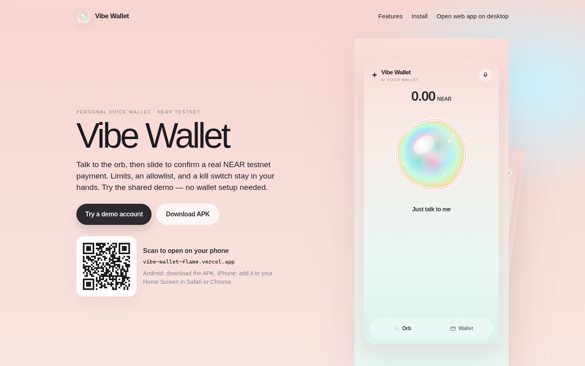
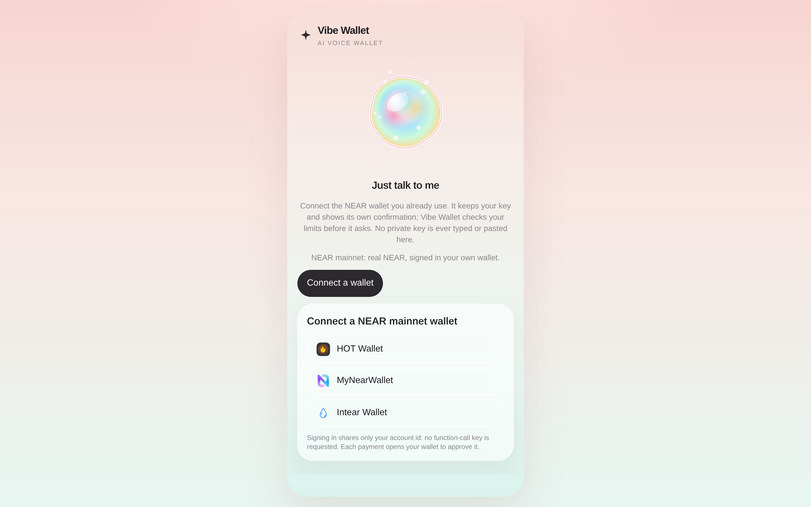
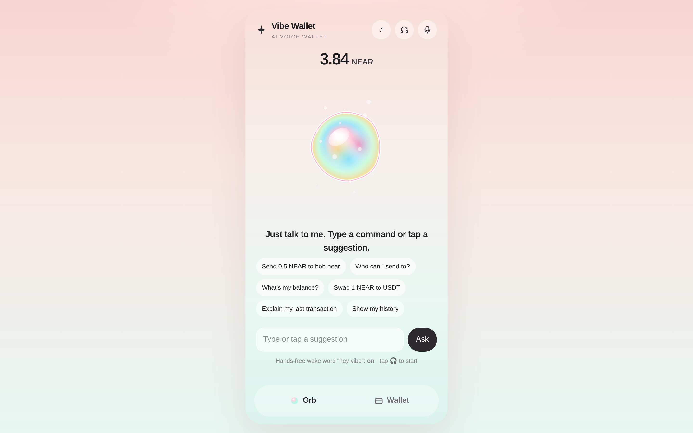
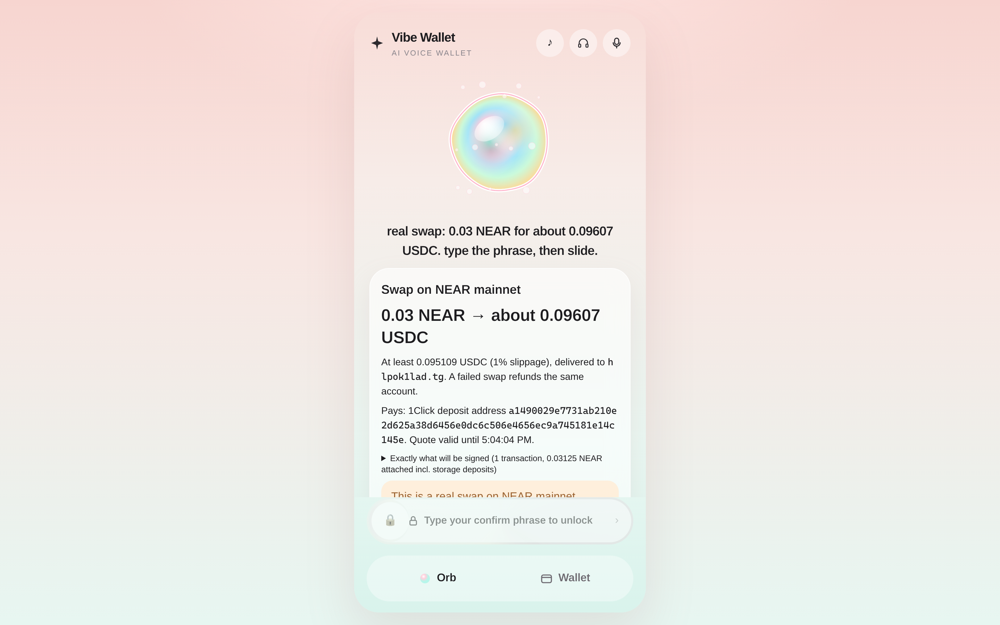
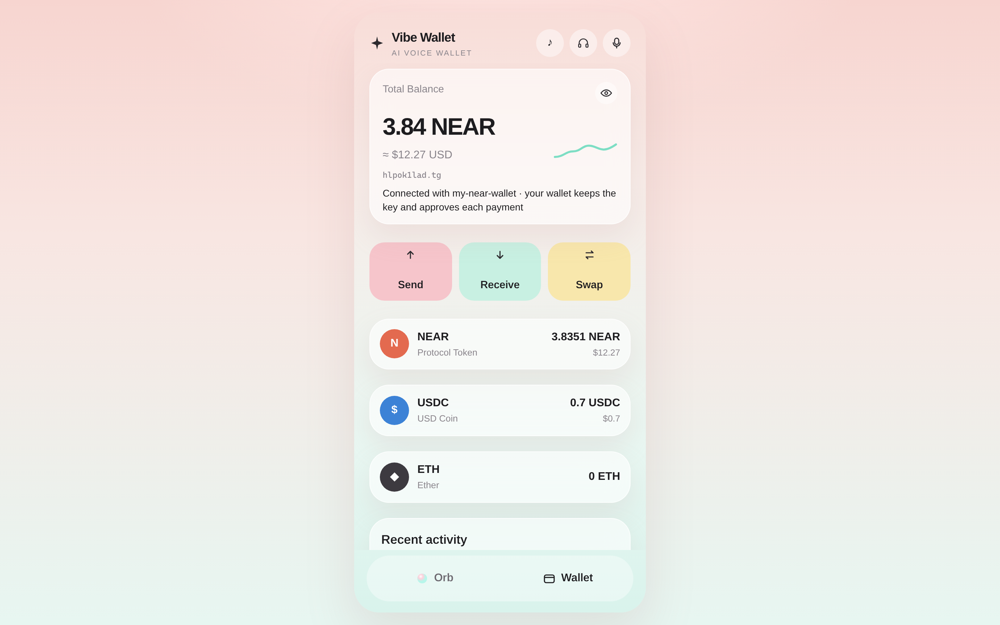
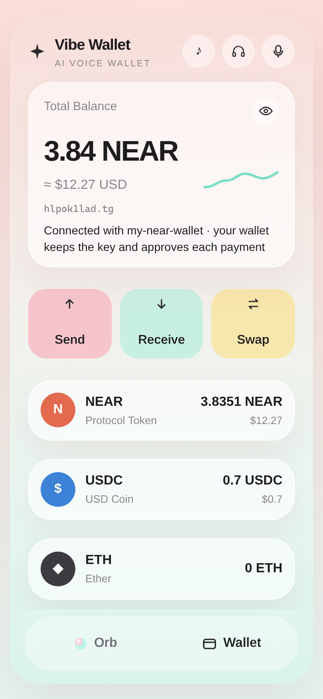
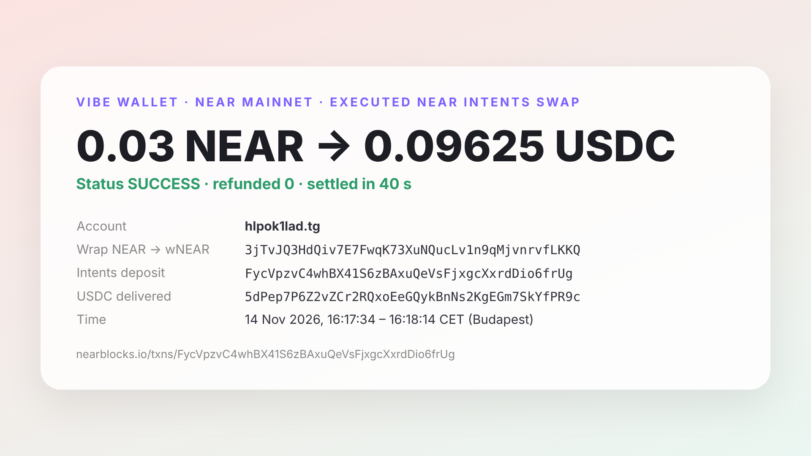
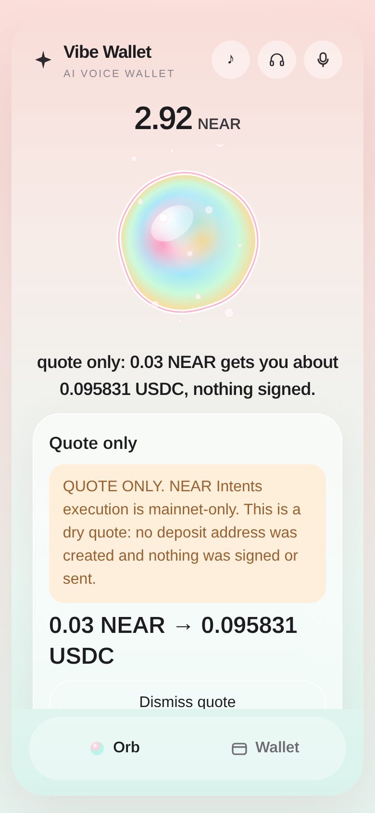
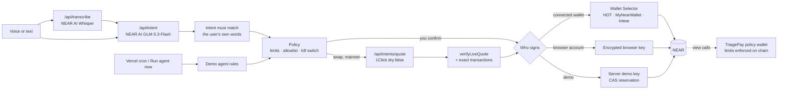

<div align="center">


# Vibe Wallet

**Talk to your NEAR wallet. NEAR AI turns your words into a proposed transaction, limits written in code
check it, and nothing is signed until you confirm: in your own wallet, or with a slide.**

[](https://vibe-wallet-flame.vercel.app)
[](https://vibe-wallet-testnet.vercel.app/?app=1&demo=1)
[](https://vibe-wallet-flame.vercel.app/download/vibe-wallet.apk)
[](#mainnet)
[](#near-technology-used)
[](#executed-near-intents-swaps-mainnet)
[](https://github.com/KhomDev/vibe-wallet/actions)
[](LICENSE)

Built at **NEAR HACKATHON 2026**

[Live app (mainnet)](https://vibe-wallet-flame.vercel.app) · [Try it free (testnet demo for judges)](https://vibe-wallet-testnet.vercel.app/?app=1&demo=1) · [Try it in 60 seconds](#try-it-in-60-seconds) · [Two layers of limits](#two-layers-of-limits-vibe-wallet--triagepay) · [Mainnet swap](#executed-near-intents-swaps-mainnet) · [Mainnet proof](#mainnet-proof) · [Security](#security-model) · [Architecture](docs/ARCHITECTURE.md)

</div>

---

## Try it free (testnet demo for judges)

No wallet, no sign-up, no real money: **[vibe-wallet-testnet.vercel.app](https://vibe-wallet-testnet.vercel.app/?app=1&demo=1)** opens the shared
testnet demo account in one tap. It is the same code as production, built for NEAR testnet, with real testnet
transfers (capped, allowlisted, rate-limited, key on the server) and NEAR Intents quotes. The production app at
[vibe-wallet-flame.vercel.app](https://vibe-wallet-flame.vercel.app) is NEAR mainnet with your own wallet.

## Screenshots

Live on **NEAR mainnet**: [vibe-wallet-flame.vercel.app](https://vibe-wallet-flame.vercel.app). Captured 14 Nov 2026 (Europe/Budapest) from the production deployment, connected (watch-only, nothing signed) as `hlpok1lad.tg`.

<p align="center"></p>

Landing page: NEAR mainnet, **Connect your NEAR wallet**, and a QR code for the phone.

<p align="center"></p>

Connect a NEAR mainnet wallet (HOT, MyNearWallet, Intear). Your wallet keeps the key and approves every payment.

<p align="center"></p>

The Orb tab with the account's real mainnet balance: talk, type, or tap a suggestion.

<p align="center"></p>

*"Swap 0.03 NEAR to USDC"* → a verified, executable NEAR Intents quote on mainnet, delivered to and refunded to your own account. Type the phrase, slide, and approve in your wallet.

<p align="center"></p>

Wallet tab: NEAR, USDC and ETH balances read from mainnet, with Send / Receive / Swap.

<p align="center"></p>

Mobile (390×844).

## Promo video

<!-- PROMO_VIDEO_SLOT: keep this heading. Replace the placeholder line below with a 16:9 embed (or a link to the file) when the final render is ready. The 9:16 cut is for the X submission post. Do not delete these markers. -->

_Official 16:9 demo video will be embedded here._

<!-- /PROMO_VIDEO_SLOT -->

## What it is

Vibe Wallet is a voice-first NEAR wallet app: a Next.js web app that also installs as a PWA, plus an
Android wrapper. You say or type what you want. Some examples:

- *"send 0.1 NEAR to bob"*
- *"swap 0.03 NEAR to USDC"*
- *"what did my last transaction do?"*
- *"every Friday send 0.1 NEAR to my editor"*

Here is what happens next:

1. **Transcribe.** NEAR AI Cloud turns your audio into text with Whisper.
2. **Propose.** NEAR AI (GLM-5.3-Flash) turns the text into one **typed intent**: a small JSON object such
   as `{"type":"send","recipient":"bob.near","amountNear":"0.1"}`. The model never sees a key and cannot
   sign anything.
3. **Check your words.** The intent is kept only if your own words back it: the recipient is a name you
   said, and the amount is a number you said.
4. **Check the policy.** A deterministic policy checks it against your per-send and daily limits, your
   allowlist, the kill switch, the live balance, and whether the recipient exists.
5. **Show the card.** A confirm card shows exactly what will be signed.
6. **Confirm.** You confirm by sliding, plus typing your confirm phrase when the policy asks for it.
   **Your own wallet** (HOT, MyNearWallet or Intear, through NEAR Wallet Selector) then shows its own
   approval screen and signs. The app never holds your key.

On mainnet the same flow executes a real **NEAR Intents** swap from the confirm card, under the same limits.

Demo video: [demo/vibe-wallet-demo.mp4](demo/vibe-wallet-demo.mp4) (captions: [demo/vibe-wallet-demo.srt](demo/vibe-wallet-demo.srt)).

## How it helps

| Problem with today's wallets | What Vibe Wallet does instead |
| --- | --- |
| You copy 64-character addresses, pick networks and read raw transactions | Say a name and an amount. "bob" resolves to `bob.near` on mainnet or `bob.testnet` on testnet. "Explain my last transaction" answers in plain words |
| An AI assistant that can act on its own can be fooled by a misheard word or a prompt injection | The AI can only *propose*. If you didn't say the recipient or amount, the proposal is dropped. Limits are code, not a prompt, and you confirm every send |
| Wallet apps ask you to paste a private key | You connect the wallet you already use. It keeps the key and shows its own approval for every payment |
| One mistake can empty a hot wallet | A per-send cap, a daily cap, an allowlist, an extra-confirm amount and a kill switch, all checked again right before anything is signed |
| Swapping tokens means another app and another approval screen | "swap 0.03 NEAR to USDC" gives a verified NEAR Intents quote and the exact transaction, under your limits |
| AI agents that pay on your behalf need limits the AI cannot bypass | With [TriagePay](#two-layers-of-limits-vibe-wallet--triagepay), a smart contract enforces an agent's limits on chain. Vibe Wallet shows them live |

Who it is for: people who want crypto payments to feel like a banking app, and wallets or apps that want a
voice and AI layer with guardrails instead of building one.

## Three ways to use it

| | **Connect your wallet** (recommended) | **New testnet account** | **Shared demo account** |
| --- | --- | --- | --- |
| For | Your real account, on testnet or mainnet | Trying the app with a fresh account in one tap | Judges and first-time visitors: no wallet, no sign-up |
| Who holds the key | Your wallet (HOT, MyNearWallet or Intear, through [NEAR Wallet Selector](https://github.com/near/wallet-selector)). The app only gets your account id; no function-call key is requested at sign-in | Generated in this browser and encrypted here (vault v2: PBKDF2-SHA256 600,000 iterations → AES-GCM-256, 12+ character passphrase). Never typed, pasted or sent anywhere | The server's environment. It never reaches the browser |
| Who signs | Your wallet, after its own confirmation screen | Your browser | The server, testnet only |
| Limits | Yours, checked by the app before it asks your wallet to sign. Defaults: 2 NEAR per send, 5 per day, extra confirm at 0.5, allowlist-only off | Yours, checked again inside the signer | Fixed and enforced on the server, see [Demo limits](#demo-limits) |
| Network | Testnet, or mainnet in a mainnet build | Testnet only (faucet) | Testnet only: the signer refuses any node that is not `chain_id: testnet` |
| Swaps | Executed NEAR Intents swaps on mainnet; dry quotes on testnet | Dry quotes | Dry quotes |
| Agent rules | Not in this build | Not in this build | Yes: each rule belongs to your visitor cookie |

Pasting a private key into the app is no longer offered. Browser wallets created earlier still unlock with
their passphrase.

## Two layers of limits: Vibe Wallet + TriagePay

Our team built two NEAR HACKATHON projects that put limits between an AI and your money at two different layers:

| | **Vibe Wallet** (this repo) | **[TriagePay](https://github.com/KhomDev/TriagePay)** |
| --- | --- | --- |
| Who it protects | A person talking to their wallet | An owner whose AI agent pays for things on its own |
| Where the limits run | In the app, before it asks your wallet (or the browser key) to sign | In a NEAR smart contract, on every payment |
| What it stops | A misheard word, a prompt injection, or a model that invents a recipient or amount | A hijacked agent, even one holding its own key: payments outside the limits are refused by the chain |
| Confirmation | You, for every send | The contract; above a threshold, the owner approves on chain |

**What is integrated today:**

- **Live card.** The Wallet tab has a **Limits enforced on chain** card that reads a deployed TriagePay
  policy wallet with view calls only. It shows the agent's per-payment cap, daily cap, remaining budget,
  payee allowlist, owner-review threshold, review queue, and pause flag.
- **Voice.** Saying "show on-chain limits" opens the same card.
- **Defaults.** Mainnet reads [`tp-wallet.hlpok1lad.tg`](https://nearblocks.io/address/tp-wallet.hlpok1lad.tg)
  with agent `tp-agent2.hlpok1lad.tg`. Testnet reads `tpd-e947e7-wallet.testnet`. Set
  `NEXT_PUBLIC_POLICY_WALLET_ID` and `NEXT_PUBLIC_POLICY_AGENT_ID` to point at another wallet.
- **Verified on mainnet.** The values the card shows are part of the mainnet check below: agent active,
  payee `gateway.hlpok1lad.tg`, 1e6 / 4e6 yocto-wNEAR per payment / per day.

**Next:** Vibe Wallet's agent rules pay through a TriagePay policy wallet, so the agent holds a pay-only
function-call key. Even a compromised app server could not exceed the contract's limits. That is the
roadmap, not this build.

## How a send is confirmed

Nothing moves without one of these, and the policy always runs first:

1. **Slide to confirm** on the confirm card. Keyboard users press the right arrow four times; Enter and
   Space do nothing, so a single stray keystroke cannot confirm.
2. **The confirm phrase plus the slide**, required in these cases:
   - the recipient is not on your allowlist;
   - the amount is at or above your extra-confirm threshold;
   - an implicit (64-hex) account;
   - a name that looks like one of your contacts;
   - most of your balance;
   - **every swap**.

   Your phrase is also required to add anyone to your allowlist, raise a limit, change the phrase, turn off
   allowlist-only, or resume after the kill switch.
3. **A spoken "yes" in hands-free mode**, only for an allowlisted recipient below the threshold. It must
   be the whole answer ("yes", "yes, do it", "confirm"). Any "no", "wait" or "not" cancels it. The question
   expires after 15 seconds or as soon as the card changes.
4. **In a connected wallet**, your wallet's own approval screen comes after all of the above. The app
   never asks it to sign a transaction the policy did not allow.
5. **Agent rules** (demo account) are confirmed once, when you slide to create the rule. Each payment the
   rule makes later still passes every limit and stops with the kill switch.

## Executed NEAR Intents swaps (mainnet)

In a mainnet build, *"swap 0.03 NEAR to USDC"* (typed, spoken, or from the Swap button) becomes a real swap
through NEAR Intents (the 1Click API). Here is what happens, in order:

1. **Executable quote.** The server asks 1Click for a quote with `dry: false`, which comes with a one-time
   deposit address. The server holds no key and signs nothing.
2. **Verification.** The browser checks the quote against what you asked for (`verifyLiveQuote`). It
   must match on all of these, or it is refused:
   - the same amount in;
   - the origin asset is wNEAR;
   - the destination is the token you named;
   - it delivers to **your** account;
   - it refunds **your** account if it fails;
   - the deadline is more than two minutes away;
   - the deposit address is valid and not your own account;
   - it returns more than zero.
3. **Exact transactions.** These are built from your account's on-chain state (`buildSwapTransactions`),
   and nothing else:
   - only if you are not registered on the destination token yet: `storage_deposit` there (0.00125 NEAR),
     so the tokens can be delivered back to you;
   - one transaction to `wrap.near`:
     - `storage_deposit` for you, only if needed;
     - `near_deposit` for the wNEAR shortfall, only if needed;
     - `storage_deposit` for the deposit address;
     - `ft_transfer` of exactly the quoted amount to the deposit address.
4. **The swap card.** It shows the amount in, the expected and minimum amount out, the deposit address, the
   quote's expiry, and every action with its arguments and deposit.
5. **Limits** (`assessSwap`). The swap amount counts against your per-send and daily limits. The kill switch
   stops it. Your balance must cover the amount plus storage deposits and fees. There is a 1 NEAR ceiling
   per swap (`SWAP_MAX_NEAR`). **The confirm phrase is always required.**
6. **Signing.** You type the phrase and slide. Your wallet shows the transaction and asks for approval.
   With a browser key, the app signs it, and only for `wrap.near` and the destination token.
7. **Settlement.** The app reports the deposit transaction to 1Click and polls the status until it is
   `SUCCESS`, `REFUNDED` or `FAILED`, then shows the result.

On testnet, NEAR Intents has no execution, so the same command returns a **dry quote**, labeled quote-only.

**Checked on mainnet (14 Nov 2026), up to the signature:** an executable quote for 0.03 NEAR → USDC on
`hlpok1lad.tg` passed verification, delivering to and refunding that account. The built swap was one
transaction to `wrap.near`: `near_deposit` 0.03 NEAR, `storage_deposit` for the deposit address, and
`ft_transfer`, 0.03125 NEAR attached in total. The policy allowed it with the phrase required. It was not
signed: the person holding the key approves it in their wallet. Evidence:
[docs/evidence/mainnet-check-2026-11-14.json](docs/evidence/mainnet-check-2026-11-14.json).

### Run the mainnet swap yourself

```bash
cd app-v4 && npm install && NEXT_PUBLIC_NEAR_NETWORK=mainnet npm run build && NEXT_PUBLIC_NEAR_NETWORK=mainnet npm start
```

1. Open http://127.0.0.1:43123/?app=1, choose **Connect a wallet**, and pick the wallet that holds your
   mainnet account (HOT for `.tg` accounts, or MyNearWallet or Intear).
2. Type or say `Swap 0.03 NEAR to USDC`. The swap card lists every action.
3. Type your confirm phrase (default `confirm send`), slide, and approve in your wallet.
4. Watch the status go to `SUCCESS`; USDC arrives in the same account.

## Try it in 60 seconds

The production site runs on **mainnet** with your own wallet (see [Mainnet](#mainnet)). These steps use the free shared demo at **[vibe-wallet-testnet.vercel.app](https://vibe-wallet-testnet.vercel.app/?app=1&demo=1)** (a testnet build: no real money, no wallet, no sign-up). Each step is *do X → see Y*.

1. **Open** https://vibe-wallet-testnet.vercel.app/?app=1 → **see** the orb screen.
2. **Tap** **Try a demo account** → **see** the orb greet you with the demo account's testnet balance.
3. **Tap** **What's my balance?** (or tap the orb and say it) → **see** the balance read back, labeled with whether NEAR AI or the local parser answered.
4. **Tap** **Send 0.1 NEAR to demo friend** → **see** a confirm card with recipient, amount, fee and balance after the send. 0.1 is below the demo's 0.2 NEAR extra-confirm amount, so no phrase is needed.
5. **Slide to confirm** → **see** "Sent 0.1 NEAR" and a **View transaction** link to the real transaction on testnet.nearblocks.io.
6. **Tap** **Who can I send to?**, then **Send 0.1** on the demo friend → the command box is prefilled. Change `0.1` to `0.3` and press **Ask** → the card asks for the phrase because 0.3 is at or above 0.2. Type `confirm send`, then slide.
7. **Type** `Send 5 NEAR to bob.testnet` → **see** the orb turn red and say why it is blocked. Nothing is signed.
8. **Type** `Swap 1 NEAR to USDC` → **see** a live NEAR Intents quote, labeled quote-only on testnet.
9. **Tap** **Every day send 0.1 NEAR**, then slide → **see** the rule under **Autonomous agent** in the **Wallet** tab. Press **Run agent now** → **see** a real scheduled payment in the **Activity log**. Running it again the same day does not pay twice.
10. **Type** `show on-chain limits` → **see** the TriagePay policy wallet's limits, read live from its contract.
11. **Type** `Send 0.1 NEAR to bob.testnet` → blocked (allowlist-only) with an **Add bob.testnet to allowlist** button → tap it → it asks for the confirm phrase first, then drafts the send again for your slide.
12. **Open** the **Wallet** tab and press **Stop all sending** → **see** your sends and agent rules refuse to run until you resume with the phrase. Other visitors are not affected.

## What you can say

| Say or type | What happens |
| --- | --- |
| "What's my balance?" | Reads your available, total and storage-locked NEAR |
| "Send 0.1 NEAR to bob.testnet" | Policy check, then a confirm card; your wallet or the slide signs |
| "Swap 0.03 NEAR to USDC" | Mainnet: a verified, executable NEAR Intents swap card. Testnet: a dry quote |
| "Who can I send to?" / "My contacts" | Your allowlist and limits; **Send 0.1** prefills a send |
| "Allow bob.testnet" | Drafts an allowlist addition that needs your confirm phrase |
| "Set daily limit to 1" | Drafts a limits change that needs your confirm phrase |
| "Show on-chain limits" | The TriagePay contract's limits, read live |
| "Send 0.1 NEAR to bob every Friday" / "Every day send 0.1 NEAR to bob" | A recurring agent payment after you slide (demo account) |
| "If NEAR drops below $2, swap 0.1 NEAR to USDC" | A price rule that fetches a dry quote when triggered (demo account) |
| "Run the agent" / "Show agent log" | Runs your due rules now / shows what the agent did |
| "Show my history" / "Explain my last transaction" | Recent transactions and a plain-language explanation |
| "Stop sending" / "Resume sending" | Kill switch on (no phrase) / off (needs the phrase) |
| "Hey vibe" (hands-free mode) | Wakes the wallet; then talk normally. "bye" or "stop" ends the session |

## Security model

- **The AI never holds a key.** NEAR AI returns one typed intent, validated against a fixed schema. It is
  kept only if your own words back it:
  - the recipient must be a whole account name you said (`alice.evil.testnet` does not pass for
    `alice.testnet`);
  - the amount must be a number you said;
  - actions such as stop or a swap need a matching word.

  "Don't send…" is never drafted as a send. Names with hidden or look-alike characters are refused.
  Otherwise a deterministic local parser decides.
- **The policy runs twice:** for the confirm card, and again right before signing with the live balance,
  account existence and fee. The second check runs before the app asks a connected wallet, and inside the
  browser signer.
- **Connected wallet:** your key stays in your wallet. Sign-in shares the account id only. Each payment
  opens your wallet's own approval. If you cancel there, or a browser wallet returns an error, the
  reserved daily spend is given back.
- **New browser account:** the key is encrypted in the browser (vault v2) and sends are serialized across
  tabs. The transaction hash is known before broadcasting, so a timed-out send is looked up instead of
  retried blindly. A pasted private key or seed phrase is stopped before it leaves the browser.
- **Swaps:** the quote is verified to deliver to and refund your own account. Only the listed actions are
  signed, the confirm phrase is always required, and a 1 NEAR ceiling applies per swap.
- **Shared demo account:**
  - Every server-side limit is checked, and the spend reserved, in one atomic compare-and-swap write before
    the server signs.
  - Each send needs a single-use token from its own preview, bound to your visitor id, the recipient and
    the amount.
  - Your stop switch, allowlist and agent rules belong to your visitor cookie. Only the operator controls
    the global kill switch.
- **Web hardening:**
  - A CSP with `frame-ancestors 'none'` and `X-Frame-Options: DENY`: the app cannot be framed, and scripts
    load from the app's own origin only.
  - Cross-site and non-JSON state-changing requests are rejected.
  - API responses are never cached.
  - The paid NEAR AI routes are rate-limited.
- **Dependencies:** wallet modules are pinned to exact versions and loaded lazily. Meteor Wallet's SDK
  was left out because it pulls dependencies with open high-severity advisories. Production dependencies
  have 0 high and 0 critical advisories.

The full record: [docs/SECURITY-REVIEW-2026-11-14.md](docs/SECURITY-REVIEW-2026-11-14.md). An internal
review found 0 Critical, 0 High, 8 Medium, 18 Low and 13 Info. 33 are fixed and tested, 3 are fixed in the
Android source for APK 1.2, and 3 are operator actions. Reporting a vulnerability: [SECURITY.md](SECURITY.md).

### Demo limits

All enforced on the server (`app-v4/lib/server/demo-limits.ts`):

| Scope | Limit |
| --- | --- |
| Per send | 0.3 NEAR, allowlisted recipients only; the phrase is also needed at or above 0.2 NEAR |
| Per visitor (signed cookie) | 2 NEAR per UTC day, 8 sends per hour, 20 per day |
| Per network (hashed IP) | 3 NEAR per UTC day, 15 sends per hour, 40 per day, 20 new visitor ids per day |
| Whole demo account | 20 NEAR per UTC day (amounts plus fees), 120 sends per hour |
| Agent | 3 rules per visitor; each payment counts against the owner's visitor, network and global limits |

## Mainnet proof

**14 Nov 2026, 16:17–16:18 CET: one executed NEAR Intents swap on NEAR mainnet**, run through the app's own
executed-swap path (`lib/server/intents-swap.ts`, 1Click `dry:false`, 0.05 NEAR cap), account `hlpok1lad.tg`.

| Step | Mainnet transaction |
|---|---|
| Wrap 0.03 NEAR → wNEAR | [3jTvJQ3H…LKKQ](https://nearblocks.io/txns/3jTvJQ3HdQiv7E7FwqK73XuNQucLv1n9qMjvnrvfLKKQ) |
| **Swap: Intents deposit of 0.03 wNEAR → 0.09625 USDC, status `SUCCESS`** | [FycVpzvC…frUg](https://nearblocks.io/txns/FycVpzvC4whBX41S6zBAxuQeVsFjxgcXxrdDio6frUg) |
| USDC delivered to `hlpok1lad.tg` (`intents.near::execute_intents`) | [5dPep7P6…PR9c](https://nearblocks.io/txns/5dPep7P6Z2vZCr2RQxoEeGQykBnNs2KgEGm7SkYfPR9c) |

<p align="center"> </p>

Full record (quote, deposit address, intent hashes, settlement): [docs/evidence/mainnet-swap-2026-11-14.json](docs/evidence/mainnet-swap-2026-11-14.json).

## Mainnet

**The deployed app runs on NEAR mainnet** (since 14 Nov 2026): production on Vercel is built with
`NEXT_PUBLIC_NEAR_NETWORK=mainnet`, reads the free FastNEAR mainnet RPC, and quotes real swaps through the
NEAR Intents 1Click API. Every send and swap is signed by the user's own wallet (HOT, MyNearWallet, Intear);
the server holds no mainnet key. The shared demo account, its agent and the daily cron are testnet-only: in a
mainnet build their routes return 404, so anonymous visitors can't act on mainnet. A testnet build (the
default, `NEXT_PUBLIC_NEAR_NETWORK` unset) keeps the free shared demo; it runs as a separate Vercel project at
[vibe-wallet-testnet.vercel.app](https://vibe-wallet-testnet.vercel.app), linked from the mainnet landing page (`NEXT_PUBLIC_TESTNET_DEMO_URL`).

**13 Nov 2026, real transactions** through the app's code (`scripts/mainnet-proof.ts`, account `hlpok1lad.tg`):

| Action | Mainnet transaction |
| --- | --- |
| 0.01 NEAR transfer through the signer (allowlist-only policy, 0.05 NEAR per-send cap, full-access key check) | [A4yAYiZC…EcEXyu](https://nearblocks.io/txns/A4yAYiZCYoS5QD5m6bq8bchBcBYZdVP7eZbMCkEcEXyu) |
| Wrap 0.03 NEAR to wNEAR for the Intents deposit | [8w76GGqB…oAVE](https://nearblocks.io/txns/8w76GGqBDSchTfpqrT8W5cGxvmNtu7uSzN4AaiMwoAVE) |
| **Executed NEAR Intents swap** via 1Click: 0.03 NEAR → 0.106562 USDC, status `SUCCESS` | [AbmBP4bS…TCMZv2](https://nearblocks.io/txns/AbmBP4bSxeoSS3eNZ6zvZmgD3stsXK1JdhaQqgTCMZv2) |
| USDC delivered back to the account on NEAR | [8ZSc3Uhn…kw5c](https://nearblocks.io/txns/8ZSc3Uhnif6NB9emVHtqv7iXXJW6kvZio5u2aMwkJw5c) |

**14 Nov 2026, the current logic against live mainnet** (`npm run mainnet:check`): **16 of 16 checks pass**.
The check needs no private key and signs nothing.

- **Network:** the node reports `chain_id: mainnet`, and the shared-demo signer refuses to sign there.
- **Policy:** on the live balance it allows 0.01 NEAR with the slide only, asks for the phrase at 0.05,
  and blocks 0.06 (over the cap) and an unknown recipient.
- **Signer checks:** the account's full-access key is visible to the signer's key check, and the three
  proof transactions reconcile by hash.
- **Quotes:** a dry quote works.
- **TriagePay:** the policy wallet's limits are read from its contract.
- **Swap:** the confirm-card swap was built and verified up to the signature, as described above.

Evidence: [docs/evidence/mainnet-check-2026-11-14.json](docs/evidence/mainnet-check-2026-11-14.json). Details:
[docs/MAINNET.md](docs/MAINNET.md).

## Architecture



- **Frontend:** Next.js 15, React 19, Framer Motion orb, PWA, and a Capacitor Android wrapper.
- **Wallets:** NEAR Wallet Selector 10.1.4 with HOT, MyNearWallet and Intear, loaded on demand, with
  FastNEAR RPC.
- **AI:** NEAR AI Cloud for speech-to-text and intent classification. The keys stay on the server.
- **Chain:** `near-api-js` with FastNEAR RPC. Browser signing lives in `lib/near/signer.ts`, wallet
  signing in `lib/near/wallet-send.ts`, demo signing in `lib/server/transfer.ts`. A test checks that API
  routes never import the browser signer.
- **Intents:** `lib/intents-swap-client.ts` (verify and build) and `app/api/intents/*` (quote, submit,
  status), mainnet only.
- **Demo state:** one JSON document in private Vercel Blob, changed only by compare-and-swap writes.

Full detail: [docs/ARCHITECTURE.md](docs/ARCHITECTURE.md).

## NEAR technology used

| NEAR technology | How Vibe Wallet uses it |
| --- | --- |
| **NEAR AI Cloud** | `openai/whisper-large-v3` for voice and `z-ai/glm-5.3-flash` for intent extraction, via `cloud-api.near.ai` |
| **NEAR Intents (1Click API)** | Executed swaps from the confirm card on mainnet (quote verified, exact transactions signed by your wallet); dry quotes on testnet; executed swaps on mainnet on 13 and 14 Nov |
| **NEAR Wallet Selector** | HOT, MyNearWallet and Intear connect; your wallet signs every payment |
| **Smart-contract limits (TriagePay)** | Live view of a policy-wallet contract that enforces an agent's caps and payee allowlist on chain |
| **Native transfers** | Real `Transfer` actions on testnet and mainnet |
| **Fungible tokens (NEP-141)** | wNEAR wrap, storage registration and `ft_transfer` for the Intents deposit; USDC/USDT delivery |
| **Access keys** | Full-access key checks before signing; an optional function-call key limited to two view methods with a 0.05 NEAR allowance |
| **Named and implicit accounts** | `.near`/`.tg`/`.testnet` names and 64-hex implicit accounts; a funded `.testnet` account in one tap |
| **NEAR Social** | A public projection of the demo agent's rules and payments, mirrored to `v1.social08.testnet` by the cron |

## What is real and what is not

- **Real:**
  - testnet transfers from the app and the demo, and agent payments;
  - NEAR AI transcription and intents;
  - the live TriagePay contract reads;
  - executable 1Click quotes on mainnet;
  - the mainnet transactions linked above.
- **Real, but you sign it:** the confirm-card swap on mainnet. The whole path up to the signature was run
  on mainnet; the signature is yours, in your wallet.
- **Quote only:** swaps on testnet, and price rules (they fetch a dry quote when triggered).
- **Not in this build:**
  - agent rules for personal wallets;
  - routing agent payments through TriagePay (read-only integration today);
  - Meteor Wallet;
  - hardware-backed keys for browser accounts.
- **Not audited** by a third party. The security review is an internal red-team review.

## Business model

> This is the plan, not traction. Vibe Wallet has no paying users yet, and the numbers below are assumptions to validate.

1. **Swap fee via NEAR Intents.** 1Click supports app fees in basis points on every quote (`appFees`). We
   would charge a small, disclosed fee (for example 0.25%), paid at settlement, with no custody. The
   executed-swap path is built; the fee is one quote field away.
2. **Premium automation.** Free: voice wallet, sends, swaps, guardrails. Premium (for example
   $4.99/month): more agent rules, price rules that execute within user-set limits, on-chain policy wallets,
   and spending reports.
3. **B2B SDK.** License the voice → intent → policy → confirm pipeline (intent schema, word-binding check,
   policy engine, swap verifier, Wallet Selector integration) to wallets, exchanges and fintech apps on NEAR
   and, through Intents, other chains.

| Item | Assumption | Note |
| --- | --- | --- |
| Swap fee revenue | 0.25% of volume | A $40 swap earns $0.10 |
| AI cost per voice command | A few tenths of a cent | One short Whisper clip plus one small GLM-Flash call; to be measured |
| Chain cost per send | Under $0.01 | NEAR transfer fees are fractions of a cent |

Go-to-market: NEAR community and hackathon audiences first; then creators (voice tipping, recurring
payments); then partner wallets through the SDK; then cross-chain payouts through Intents.

## Roadmap

| Phase | Scope |
| --- | --- |
| **Now (hackathon)** | Live on NEAR mainnet; voice wallet; NEAR AI intents bound to your words; Wallet Selector (no key pasting); guardrails and kill switch; executed NEAR Intents swaps from the confirm card on mainnet; live TriagePay on-chain limits; testnet agent; security review remediated |
| **Next** | Agent payments routed through a TriagePay policy wallet (pay-only agent key, limits on chain); a browser extension that is a popup or side panel for typed or spoken commands and hands the transaction to your existing wallet to sign (no key storage in the extension); app-fee collection; APK 1.2; a shared rate-limit store |
| **Later** | Chain Signatures for multi-chain accounts; passkey-backed browser accounts; store releases; SDK beta |

## Testing

| Check | Result (14 Nov 2026) |
| --- | --- |
| Unit, route and security tests (`npm test`) | 94/94 passed. They include the real route handlers driven against a stub RPC that decodes every signed transaction, the swap verifier and builder, the rule that a blocked send never reaches the wallet, and the Wallet-tab balance retry / fallback-RPC path |
| Typecheck / lint / production build | 0 errors / 0 errors / passed |
| Local production build against NEAR testnet (`scripts/e2e-http.mjs`) | 19/19, with real transfers |
| NEAR mainnet, key-free (`npm run mainnet:check`) | 16/16, nothing signed |
| Browser load of the build | The wallet list renders HOT, MyNearWallet and Intear, with no CSP violations |
| Playwright (desktop, iPhone 13 and Pixel 7 profiles) | Last run on 13 Nov; not re-run for the 14 Nov changes |

GitHub Actions runs lint, typecheck, unit tests and a production build on every push. Details: [docs/TESTING.md](docs/TESTING.md).

## Run it locally

```bash
cd app-v4 && npm install && cp .env.example .env.local && npm run dev
```

Then open http://127.0.0.1:43123/?app=1. Variable names and purposes are in `app-v4/.env.example`; never
commit values. Without `NEAR_AI_API_KEY`, the deterministic local parser answers, and the UI says so. For
mainnet, set `NEXT_PUBLIC_NEAR_NETWORK=mainnet`.

Note: `https://vibe-wallet.vercel.app` is an unrelated third-party app. The live URL is `https://vibe-wallet-flame.vercel.app`.

## Team

Hackathon submitter (this project and [TriagePay](https://github.com/KhomDev/TriagePay)):

- **Yura (Yuriy Khomenkov)** — team lead · email [yuriykhomekov@gmail.com](mailto:yuriykhomekov@gmail.com) · GitHub [@KhomDev](https://github.com/KhomDev) · X [@YKhomenkov](https://x.com/YKhomenkov)

## License

[MIT](LICENSE)
