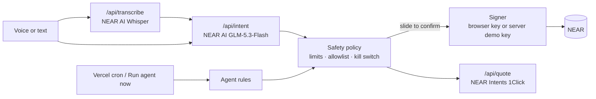

<div align="center">


# Vibe Wallet

**Talk to your NEAR wallet. It listens, proposes, and waits for your slide before a single yocto moves.**

[](https://vibe-wallet-flame.vercel.app)
[](https://vibe-wallet-flame.vercel.app/download/vibe-wallet.apk)
[](#mainnet-proof)
[](#near-technology-used)
[](https://github.com/KhomDev/vibe-wallet/actions)
[](LICENSE)

Built at **NEAR HACKATHON 2026**

[Live demo](https://vibe-wallet-flame.vercel.app) · [Android APK](https://vibe-wallet-flame.vercel.app/download/vibe-wallet.apk) · [Try it in 60 seconds](#try-it-in-60-seconds) · [Architecture](docs/ARCHITECTURE.md) · [Business model](#business-model)

</div>

---

## Demo video

**Coming soon.** A 1–2 minute walkthrough will be linked here.

## The problem

Crypto wallets still ask people to think like a blockchain: copy a 64-character address, pick a network, read gas, and approve a transaction they cannot really read. AI assistants promise to fix that, but an assistant that can move money on its own is a new risk: a misheard word or a prompt injection becomes a lost payment.

People need a wallet they can simply talk to, and they need hard guarantees that the AI can only *propose*, never *spend*.

## The solution

Vibe Wallet is a voice-first NEAR wallet built around one rule: **the AI proposes, you dispose.**

1. You speak (or type): *"Send 0.1 NEAR to my friend"*, *"Every Friday send 0.1 NEAR to Bob"*, *"If NEAR drops below $2, swap 0.1 NEAR to USDC"*.
2. NEAR AI Cloud transcribes the audio (Whisper) and turns it into a structured intent (GLM-5.3-Flash). The model can only return a typed intent; it never sees a key.
3. A deterministic safety policy checks the intent: per-transaction and daily limits, allowlist, account existence, and the kill switch.
4. You **slide to confirm**. Only then is the transaction signed: in your browser for your own wallet, or on the server for the shared demo account.
5. You get a NearBlocks link for the real on-chain transaction.

## Live demo and downloads

| | |
| --- | --- |
| Web app (desktop shows a landing page with a QR code) | https://vibe-wallet-flame.vercel.app |
| Open the wallet directly on desktop | https://vibe-wallet-flame.vercel.app/?app=1 |
| Android APK (signed) | https://vibe-wallet-flame.vercel.app/download/vibe-wallet.apk |
| iPhone | Open the site in Safari or Chrome (iOS 16.4+), then Share → Add to Home Screen |

The live app runs on **NEAR testnet** by default, so judges can try every flow with no real money. Real mainnet execution is proven separately below.

## Key features

| Feature | What it does |
| --- | --- |
| **Voice** | Tap the orb and speak. Audio is recorded on the device and transcribed by NEAR AI Cloud `openai/whisper-large-v3`. Works in Chrome, Safari, Brave, Edge, the Android WebView, and the PWA. |
| **AI intents via NEAR AI Cloud** | `z-ai/glm-5.3-flash` converts speech or text into a typed intent: balance, send, swap, history, schedule, price rule. A deterministic local parser takes over if the model is unavailable, and the UI says so. Model-invented recipients are rejected. |
| **On-chain agent rules** | Recurring payments ("every Friday") and price triggers ("if NEAR drops below $2"). A Vercel cron runs the agent daily; judges can press **Run agent now**. Scheduled payments are real transfers inside the same limits. |
| **Spending guardrails** | Per-transaction cap, daily cap, and an extra confirm phrase above a threshold. Enforced before signing, on the server for the demo account. |
| **Kill switch** | **Stop all sending** halts every send, including the autonomous agent. Balance, history, and quotes keep working. |
| **Slide-to-confirm** | Nothing is signed until you physically slide. Blocked commands turn the orb red and it says why out loud. |
| **Allowlist** | Restrict sends to named accounts only. The demo account is allowlist-only. |
| **NEAR Intents swaps** | Live 1Click quotes in the app. Executed mainnet swaps are implemented in `lib/server/intents-swap.ts` and proven on-chain (see [Mainnet proof](#mainnet-proof)). |
| **Scoped agent key** | The app adds a function-call access key limited to two view-style methods with a 0.05 NEAR allowance. A function-call key cannot transfer NEAR. |

## Try it in 60 seconds

No wallet, no sign-up. Each step is *do X → see Y*.

1. **Open** https://vibe-wallet-flame.vercel.app/?app=1 (or scan the QR code on the desktop landing page with your phone) → **see** the orb screen.
2. **Tap** **Try a demo account** → **see** the orb greet you with the demo account's testnet balance.
3. **Tap** the chip **What's my balance?** (or tap the orb and say it) → **see** the balance read back, with a label showing whether NEAR AI or the local parser answered.
4. **Tap** the chip **Send 0.1 NEAR to demo friend** → **see** a confirm card with recipient, amount, fee, and balance after the send.
5. **Type** `confirm send` in the phrase field and **slide to confirm** → **see** "Sent 0.1 NEAR" and a **View transaction** link to a real transaction on testnet.nearblocks.io.
6. **Type** `Send 5 NEAR to bob.testnet` → **see** the orb turn red and say why it is blocked (for example, over the per-transaction cap or not on the allowlist). Nothing is signed.
7. **Type** `Swap 1 NEAR to USDC` → **see** a live NEAR Intents quote from the 1Click API, labeled quote-only on testnet.
8. **Tap** the chip **Every Friday send 0.1 NEAR**, then slide → **see** the rule appear under **Autonomous agent** in the **Wallet** tab. Press **Run agent now** → **see** the agent's action in the **Activity log**.
9. **Open** the **Wallet** tab and press **Stop all sending** → **see** sends and the agent refuse to run until you press **Resume sending**.

## Mainnet proof

The deployed app stays on testnet for safety, but the same signer code and a real NEAR Intents swap were executed on **NEAR mainnet** on 13 Nov 2026 with `scripts/mainnet-proof.ts` (account `hlpok1lad.tg`, total cost about 0.04 NEAR):

| Action | Mainnet transaction |
| --- | --- |
| 0.01 NEAR transfer through `executeTransfer` (allowlist-only policy, 0.05 NEAR per-tx cap, confirm flag, full-access key check) | [A4yAYiZC…EcEXyu](https://nearblocks.io/txns/A4yAYiZCYoS5QD5m6bq8bchBcBYZdVP7eZbMCkEcEXyu) |
| Wrap 0.03 NEAR to wNEAR for the Intents deposit | [8w76GGqB…oAVE](https://nearblocks.io/txns/8w76GGqBDSchTfpqrT8W5cGxvmNtu7uSzN4AaiMwoAVE) |
| **Executed NEAR Intents swap** via 1Click: 0.03 NEAR → 0.106562 USDC, status `SUCCESS` (deposit) | [AbmBP4bS…TCMZv2](https://nearblocks.io/txns/AbmBP4bSxeoSS3eNZ6zvZmgD3stsXK1JdhaQqgTCMZv2) |
| USDC delivered back to the wallet on NEAR (settlement) | [8ZSc3Uhn…kw5c](https://nearblocks.io/txns/8ZSc3Uhnif6NB9emVHtqv7iXXJW6kvZio5u2aMwkJw5c) |

Details and how to reproduce: [docs/MAINNET.md](docs/MAINNET.md). Mainnet is opt-in with `NEXT_PUBLIC_NEAR_NETWORK=mainnet`; testnet is always the default.

## Architecture



- **Frontend:** Next.js 15, React 19, Framer Motion orb, PWA, Capacitor Android wrapper.
- **AI:** NEAR AI Cloud for speech-to-text and intent classification. Keys stay server-side.
- **Chain:** `near-api-js` with FastNEAR RPC. Signing is isolated in `lib/near/signer.ts` (browser) and `lib/server/transfer.ts` (demo); API routes are tested not to import the browser signer.
- **Agent:** rules and logs in private Vercel Blob, mirrored on NEAR Social testnet; executed by Vercel Cron.

Full detail: [docs/ARCHITECTURE.md](docs/ARCHITECTURE.md).

## NEAR technology used

| NEAR technology | How Vibe Wallet uses it |
| --- | --- |
| **NEAR AI Cloud** | `openai/whisper-large-v3` for voice and `z-ai/glm-5.3-flash` for intent extraction, both through `cloud-api.near.ai`. |
| **NEAR Intents (1Click API)** | Live quotes in the app; executed NEAR → USDC swap on mainnet (`lib/server/intents-swap.ts`). |
| **Native transfers** | Real `Transfer` actions on testnet in the app, and on mainnet in the proof. |
| **Access keys** | Full-access key encrypted in the browser for personal wallets; a scoped function-call key for the agent with a 0.05 NEAR allowance. |
| **Named and implicit accounts** | Create a funded `.testnet` account in one tap, or import any named or implicit account. |
| **NEAR Social** | Agent state mirrored on `v1.social08.testnet`. |

## Security model

- **The AI never holds a key.** Models return a typed intent only. Recipients that do not appear in the user's own words are rejected.
- **Every send passes the policy** (kill switch, per-tx cap, daily cap, allowlist, account existence, confirm phrase above a threshold) and then requires an explicit slide.
- **Personal wallets:** the full-access key is encrypted in the browser and never sent to a server.
- **Shared demo account:** the key lives only in server environment variables. Server-side caps: 0.3 NEAR per transaction, 2 NEAR per UTC day, allowlist-only, confirm phrase, and rate limits of 8 sends per hour and 20 per day.
- **Agent:** runs inside the same limits and stops when the kill switch is on.
- **Mainnet is opt-in.** Intents execution refuses to run unless the network is explicitly `mainnet`, and the proof script enforces an allowlist-only policy with a 0.05 NEAR cap.
- **Repository hygiene:** no secrets in git (`gitleaks` clean), GitHub secret scanning enabled, `.env.example` lists names only.

## Business model

> This is the plan, not traction. Vibe Wallet has no paying users yet, and the numbers below are assumptions to validate.

**Who it is for.** People who want crypto payments to feel like talking to a banking app, and wallets and apps that want a safe voice and AI layer without building one.

**Revenue streams**

1. **Swap fee via NEAR Intents.** 1Click supports app fees in basis points on every quote (`appFees`). Vibe Wallet would charge a small, disclosed fee, for example 0.25% per swap, paid at settlement with no custody.
2. **Premium automation plan.** Free tier: voice wallet, sends, quotes, guardrails. Premium (for example $4.99 per month): unlimited agent rules, price triggers that execute swaps within user-set limits, multi-account policies, and spending reports.
3. **B2B white-label SDK.** License the voice-to-intent-to-policy-to-confirm pipeline (orb UI, intent schema, policy engine, signer isolation) to wallets, exchanges, and fintech apps on NEAR and, through Intents, other chains. Priced per monthly active user or as a flat platform fee.

**Unit economics (assumptions)**

| Item | Assumption | Note |
| --- | --- | --- |
| Swap fee revenue | 0.25% of volume | A $40 swap earns $0.10 |
| AI cost per voice command | A few tenths of a cent | One short Whisper clip plus one small GLM-Flash call; to be measured in production |
| Chain cost per send | Under $0.01 | NEAR transfer fees are fractions of a cent |
| Premium gross margin | High | Agent ticks are cron jobs plus small AI calls |

The model works when an active user makes a handful of swaps per month or upgrades to Premium; AI and chain costs per user are small next to either.

**Go-to-market**

1. **NEAR community first:** launch to NEAR users and hackathon audiences with the testnet demo and mainnet beta behind strict limits.
2. **Creators and communities:** voice tipping and recurring payments ("every Friday send 1 NEAR to my editor") as a social, shareable use case.
3. **Partnerships:** offer the SDK to NEAR wallets and apps that want a voice and AI layer with built-in guardrails.
4. **Expand with Intents:** cross-chain swaps and payouts through NEAR Intents, without changing the user experience.

## Roadmap

| Phase | Scope |
| --- | --- |
| **Now (hackathon)** | Voice wallet, NEAR AI intents, guardrails, kill switch, slide-to-confirm, agent rules on testnet, executed mainnet Intents swap proof |
| **Next** | In-app mainnet mode with hardware-grade key storage, executed Intents swaps from the confirm card, app-fee collection, contacts by name |
| **Later** | Agent rules enforced by an on-chain policy contract, Chain Signatures for multi-chain accounts, iOS and Android store releases, SDK beta for partner wallets |

## Testing

| Check | Result (13 Nov 2026) |
| --- | --- |
| Unit and API route tests (`npm test`) | 23/23 passed |
| Typecheck (`npm run typecheck`) | 0 errors |
| Lint (`npm run lint`) | 0 errors |
| Production build (`npm run build`) | Passed |
| Playwright end-to-end against production | See [docs/TESTING.md](docs/TESTING.md) |

GitHub Actions runs lint, typecheck, and unit tests on every push. Details, including real-transaction e2e and voice checks: [docs/TESTING.md](docs/TESTING.md).

## Run it locally

```sh
cd app-v4
npm install
cp .env.example .env.local   # optionally set NEAR_AI_API_KEY (server-only)
npm run dev                  # http://127.0.0.1:43123
npm test
```

Environment variable names and purposes are listed in `app-v4/.env.example`. Never commit values.

Note: `https://vibe-wallet.vercel.app` is an unrelated third-party app. The live URL is `https://vibe-wallet-flame.vercel.app`.

## Sister project

Our team also built [TriagePay](https://github.com/KhomDev/TriagePay) at NEAR HACKATHON ([live demo](https://triagepay-demo.vercel.app)).

How the two differ:

- **Vibe Wallet is for people.** You talk to your NEAR wallet in plain words. NEAR AI turns what you say into a payment, a scheduled payment, a price rule or a swap, and you confirm with a slide.
- **TriagePay is for AI agents.** It's a policy wallet contract that lets an agent pay per API call over x402. Its limits, payee allowlist and owner review live on chain, so a prompt-injected agent's payment to an attacker is refused by the contract.

Both put guardrails between an AI and your money. In Vibe Wallet you approve each payment yourself, while in TriagePay the smart contract enforces the limits.

## Team

- **Sina Jalilian**: product, design, and engineering · X [@Sina02275](https://x.com/Sina02275)
- GitHub: [KhomDev](https://github.com/KhomDev)

## License

[MIT](LICENSE)
