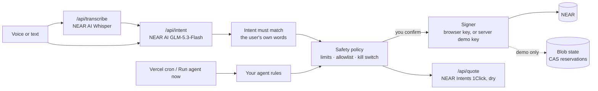

<div align="center">


# Vibe Wallet

**A NEAR wallet you talk to. NEAR AI turns what you say into a proposed transaction. Deterministic limits
check it, and nothing is signed until you confirm.**

[](https://vibe-wallet-flame.vercel.app)
[](https://vibe-wallet-flame.vercel.app/download/vibe-wallet.apk)
[](#mainnet)
[](#near-technology-used)
[](https://github.com/KhomDev/vibe-wallet/actions)
[](LICENSE)

Built at **NEAR HACKATHON 2026**

[Live demo](https://vibe-wallet-flame.vercel.app) · [Try it in 60 seconds](#try-it-in-60-seconds) · [Security](#security-model) · [Security review](docs/SECURITY-REVIEW-2026-11-14.md) · [Architecture](docs/ARCHITECTURE.md) · [Business model](#business-model)

</div>

---

## What it is, in one paragraph

Vibe Wallet is a voice-first, self-custodial NEAR wallet: a Next.js web app that also installs as a PWA, plus
an Android wrapper. You say or type what you want, for example *"send 0.1 NEAR to bob"*, *"what did my last
transaction do?"* or *"every Friday send 0.1 NEAR to my editor"*. NEAR AI Cloud transcribes the audio (Whisper)
and converts the words into one **typed intent**, a small JSON object such as
`{"type":"send","recipient":"bob.testnet","amountNear":"0.1"}`. The model never sees a key and cannot sign
anything. A deterministic policy then checks the intent against your limits, your allowlist, the live balance
and whether the account exists. The wallet shows a confirm card with the recipient, amount, fee and balance
after the send, and signs only after you slide to confirm.

Demo video: [demo/vibe-wallet-demo.mp4](demo/vibe-wallet-demo.mp4) (captions: [demo/vibe-wallet-demo.srt](demo/vibe-wallet-demo.srt)).

## How it helps

| Problem with today's wallets | What Vibe Wallet does instead |
| --- | --- |
| You copy 64-character addresses, pick networks and read raw transactions | You say a name and an amount. "bob" resolves to `bob.testnet` (`bob.near` on mainnet), and history is explained in plain words ("Explain my last transaction") |
| An AI assistant that can act on its own can be fooled by a misheard word or a prompt injection | The AI can only *propose*. A recipient or amount you did not say is thrown out. The send needs your confirmation after limits written in code, not in a prompt |
| One mistake can empty a hot wallet | Per-send cap, daily cap, allowlist, an extra-confirm amount, and a kill switch, all checked again right before signing |
| Recurring payments and price alerts need a separate service | Say "every Friday send 0.1 NEAR to bob" or "if NEAR drops below $2, quote a swap". The agent runs them inside the same limits (demo account) |
| Hands are busy | Hands-free mode: say "hey vibe", give a command, hear a short answer, and say "yes" for a small send to a trusted contact |

Who it is for: people who want crypto payments to feel like a banking app, and wallets or apps that want a
voice and AI layer with built-in guardrails instead of building one.

## Two ways to use it

| | **Your own wallet** | **Shared demo account** |
| --- | --- | --- |
| For | Real use, with your own account | Judges and first-time visitors: no wallet, no sign-up |
| Key | Your full-access key, encrypted in this browser (AES-GCM-256, PBKDF2 600,000 iterations, 12+ character passphrase). Never sent to any server | A testnet key held only in server environment variables, never sent to the browser |
| Who signs | Your browser, after the policy runs again | The server, after the same policy plus server-side limits |
| Network | Testnet by default. A mainnet build (`NEXT_PUBLIC_NEAR_NETWORK=mainnet`) imports an existing mainnet account; account creation uses the testnet faucet | Testnet only. The demo signer refuses to sign unless the node reports `chain_id: testnet` |
| Limits | Yours, defaults: 2 NEAR per send, 5 NEAR per day, extra confirm at 0.5 NEAR, allowlist-only off | Fixed, see [Demo limits](#demo-limits) |
| Agent rules | Not available in this build (the panel says so) | Yes, owned by your visitor cookie |

## How a send is confirmed

Nothing moves without one of these, and the policy always runs first:

1. **Slide to confirm** on the confirm card. Keyboard users press the right arrow four times; Enter and Space
   do nothing, so one stray keystroke or a framed page cannot confirm.
2. **The confirm phrase plus the slide**, required when the recipient is not on your allowlist, when the
   amount is at or above your extra-confirm threshold, for an implicit (64-hex) account, for a name that looks
   like a contact's, or when the send is most of your balance. Your phrase is also required to add anyone to
   your allowlist, raise a limit, change the phrase, turn off allowlist-only, or resume after the kill switch.
3. **A spoken "yes" in hands-free mode**, only for an allowlisted recipient below the threshold. It must be the
   whole answer ("yes", "yes, do it", "confirm"). Any "no", "wait" or "not" cancels, and the question expires
   after 15 seconds or as soon as the card changes. Everything else goes back to the slide.
4. **Agent rules** (demo account) are confirmed once, when you slide to create the rule. Each payment the rule
   makes later still passes every limit and stops with the kill switch.

The optional scoped agent key is never added automatically: it is a button in the Safety panel that says it
signs one AddKey transaction.

## Try it in 60 seconds

No wallet, no sign-up. Each step is *do X → see Y*.

1. **Open** https://vibe-wallet-flame.vercel.app/?app=1 (or scan the QR code on the desktop landing page) → **see** the orb screen.
2. **Tap** **Try a demo account** → **see** the orb greet you with the demo account's testnet balance.
3. **Tap** **What's my balance?** (or tap the orb and say it) → **see** the balance read back, labeled with whether NEAR AI or the local parser answered.
4. **Tap** **Send 0.1 NEAR to demo friend** → **see** a confirm card with recipient, amount, fee, and balance after the send. 0.1 is below the demo's 0.2 NEAR extra-confirm amount, so no phrase is needed.
5. **Slide to confirm** → **see** "Sent 0.1 NEAR" and a **View transaction** link to the real transaction on testnet.nearblocks.io.
6. **Tap** **Who can I send to?**, then **Send 0.1** on the demo friend → the command box is prefilled. Change `0.1` to `0.3` and press **Ask** → the card asks for the phrase because 0.3 is at or above 0.2 NEAR. Type `confirm send`, then slide.
7. **Type** `Send 5 NEAR to bob.testnet` → **see** the orb turn red and say why it is blocked (over the 0.3 NEAR per-send cap, and not on the allowlist). Nothing is signed.
8. **Type** `Swap 1 NEAR to USDC` → **see** a live NEAR Intents quote from the 1Click API, labeled quote-only.
9. **Tap** **Every day send 0.1 NEAR**, then slide → **see** the rule under **Autonomous agent** in the **Wallet** tab. Press **Run agent now** → **see** a real scheduled payment in the **Activity log**. Running it again the same day does not pay twice.
10. **Type** `Send 0.1 NEAR to bob.testnet` → **see** it blocked (allowlist-only) with an **Add bob.testnet to allowlist** button → tap it → it asks for the confirm phrase before adding anyone, then drafts the send again for your slide.
11. **Open** the **Wallet** tab and press **Stop all sending** → **see** your sends and your agent rules refuse to run until you resume with the phrase. Other visitors are not affected.

## What you can say

| Say or type | What happens |
| --- | --- |
| "What's my balance?" | Reads your available, total and storage-locked NEAR |
| "Send 0.1 NEAR to bob.testnet" | Policy check, then a confirm card and slide-to-confirm |
| "Who can I send to?" / "Show my allowlist" / "My contacts" | Your allowlisted accounts and limits; **Send 0.1** prefills a send |
| "Allow bob.testnet" | Drafts an allowlist addition that needs your confirm phrase |
| "Set daily limit to 1" | Drafts a limits change that needs your confirm phrase |
| "Swap 1 NEAR to USDC" | Live NEAR Intents quote (`dry: true`, nothing signed) |
| "Send 0.1 NEAR to bob.testnet every Friday" / "Every day send 0.1 NEAR to bob" | A recurring agent payment after you slide (demo account) |
| "If NEAR drops below $2, swap 0.1 NEAR to USDC" | A price rule that fetches a dry quote when triggered (demo account) |
| "Run the agent" / "Show agent log" | Runs your due rules now / shows what the agent did |
| "Show my history" / "Explain my last transaction" | Recent transactions and a plain-language explanation |
| "Stop sending" / "Resume sending" | Kill switch on (no phrase) / off (needs the phrase) |
| "Hey vibe" (hands-free mode) | Wakes the wallet; then talk normally. "bye" or "stop" ends the session |

## Security model

- **The AI never holds a key.** NEAR AI returns one typed intent, which is validated against a fixed schema.
  The intent is accepted only if your own words back it: the recipient must be a whole account name you said
  (`alice.evil.testnet` does not pass for `alice.testnet`), the amount must be a number you said, and actions
  such as stop or a swap quote need a matching word. "Don't send…" is never drafted as a send. Account names
  with hidden or look-alike characters are refused. Otherwise the deterministic local parser decides.
- **Every send passes the policy twice:** once for the confirm card and again inside the signer, with the
  live balance, account existence and fee. Kill switch, per-send cap, daily cap, allowlist, extra-confirm
  threshold.
- **Your own wallet:** the key is encrypted in the browser (vault v2: PBKDF2-SHA256 600,000 iterations,
  AES-GCM-256, a fresh salt and IV per encryption, AAD bound to account and key). Sends from one account are
  serialized across tabs. The transaction hash is known before broadcasting, so a timed-out send is looked up
  instead of retried blindly. A pasted private key or seed phrase is stopped before it leaves the browser.
- **Shared demo account:** every server-side limit is checked and the spend reserved in one atomic
  compare-and-swap write before the server signs. Each send needs a single-use confirmation token from its own
  preview, bound to your visitor id, the recipient and the amount. Your stop switch, allowlist and agent rules
  belong to your visitor cookie; only the operator controls the global kill switch.
- **Web hardening:** a CSP with `frame-ancestors 'none'` and `X-Frame-Options: DENY` (the app cannot be
  framed); cross-site and non-JSON state-changing requests are rejected; API responses are never cached; the
  paid NEAR AI routes are rate-limited.
- **Mainnet is opt-in** by build flag. The deployed app is testnet. In-app swaps are quotes only; executed
  Intents swaps refuse to run off mainnet.
- **Repository hygiene:** no secrets in git, `.env.example` lists names only, CI actions pinned by commit SHA
  with a read-only token.

Independent review and every fix: [docs/SECURITY-REVIEW-2026-11-14.md](docs/SECURITY-REVIEW-2026-11-14.md)
(0 Critical, 0 High, 8 Medium, 18 Low, 13 Info found; 33 fixed and tested, 3 fixed in the Android source for
APK 1.2, 3 open operator actions). Reporting a vulnerability: [SECURITY.md](SECURITY.md).

### Demo limits

All enforced on the server (`app-v4/lib/server/demo-limits.ts`):

| Scope | Limit |
| --- | --- |
| Per send | 0.3 NEAR, allowlisted recipients only; the phrase is also needed at or above 0.2 NEAR |
| Per visitor (signed cookie) | 2 NEAR per UTC day, 8 sends per hour, 20 per day |
| Per network (hashed IP) | 3 NEAR per UTC day, 15 sends per hour, 40 per day, 20 new visitor ids per day |
| Whole demo account | 20 NEAR per UTC day (amounts plus fees), 120 sends per hour |
| Agent | 3 rules per visitor; each payment counts against the owner's visitor, network and global limits |

## Live demo and downloads

| | |
| --- | --- |
| Web app (desktop shows a landing page with a QR code) | https://vibe-wallet-flame.vercel.app |
| Open the wallet directly on desktop | https://vibe-wallet-flame.vercel.app/?app=1 |
| Android APK (signed, 1.1) | https://vibe-wallet-flame.vercel.app/download/vibe-wallet.apk |
| iPhone | Open the site in Safari or Chrome (iOS 16.4+), then Share → Add to Home Screen |

The APK loads the live site, so web fixes reach it immediately. The Android wrapper hardening in
`app-v4/android` (no cloud backup, microphone-only WebView permission for the app's own origin, HTTPS-only
network config, `FLAG_SECURE`) ships with APK 1.2.

## Mainnet

The deployed app stays on testnet so anyone can try it for free. The same code was exercised on **NEAR mainnet**:

**13 Nov 2026, real transactions** with `scripts/mainnet-proof.ts` (account `hlpok1lad.tg`, about 0.04 NEAR in total):

| Action | Mainnet transaction |
| --- | --- |
| 0.01 NEAR transfer through `executeTransfer` (allowlist-only policy, 0.05 NEAR per-send cap, full-access key check) | [A4yAYiZC…EcEXyu](https://nearblocks.io/txns/A4yAYiZCYoS5QD5m6bq8bchBcBYZdVP7eZbMCkEcEXyu) |
| Wrap 0.03 NEAR to wNEAR for the Intents deposit | [8w76GGqB…oAVE](https://nearblocks.io/txns/8w76GGqBDSchTfpqrT8W5cGxvmNtu7uSzN4AaiMwoAVE) |
| **Executed NEAR Intents swap** via 1Click: 0.03 NEAR → 0.106562 USDC, status `SUCCESS` | [AbmBP4bS…TCMZv2](https://nearblocks.io/txns/AbmBP4bSxeoSS3eNZ6zvZmgD3stsXK1JdhaQqgTCMZv2) |
| USDC delivered back to the wallet on NEAR | [8ZSc3Uhn…kw5c](https://nearblocks.io/txns/8ZSc3Uhnif6NB9emVHtqv7iXXJW6kvZio5u2aMwkJw5c) |

**14 Nov 2026, the updated logic against live mainnet** with `npm run mainnet:check`, which needs no private
key and signs nothing. 12 of 12 checks pass. The node reports `chain_id: mainnet`, and the shared-demo
signer refuses to sign there. On the live balance, the policy allows 0.01 NEAR with the slide only, asks for
the phrase at the 0.05 threshold, and blocks 0.06 (over the cap) and an unknown recipient. The account's
full-access key is visible to the signer's check. All three proof transactions reconcile by hash exactly as
the new signer does after a timeout. A 1Click quote returns with `dry: true`.
Evidence: [docs/evidence/mainnet-check-2026-11-14.json](docs/evidence/mainnet-check-2026-11-14.json). Details:
[docs/MAINNET.md](docs/MAINNET.md).

## Architecture



- **Frontend:** Next.js 15, React 19, Framer Motion orb, PWA, Capacitor Android wrapper.
- **AI:** NEAR AI Cloud for speech-to-text and intent classification; keys stay on the server.
- **Chain:** `near-api-js` with FastNEAR RPC. Signing lives in `lib/near/signer.ts` (browser) and
  `lib/server/transfer.ts` (demo); a test checks that API routes never import the browser signer.
- **Demo state:** one JSON document in private Vercel Blob, changed only by compare-and-swap writes; a public
  projection is mirrored to NEAR Social by the daily cron.

Full detail: [docs/ARCHITECTURE.md](docs/ARCHITECTURE.md).

## NEAR technology used

| NEAR technology | How Vibe Wallet uses it |
| --- | --- |
| **NEAR AI Cloud** | `openai/whisper-large-v3` for voice and `z-ai/glm-5.3-flash` for intent extraction, both via `cloud-api.near.ai` |
| **NEAR Intents (1Click API)** | Live quotes in the app; an executed NEAR → USDC swap on mainnet (`lib/server/intents-swap.ts`) |
| **Native transfers** | Real `Transfer` actions on testnet in the app, and on mainnet in the proof |
| **Access keys** | A full-access key encrypted in the browser for personal wallets; an optional function-call key limited to two view methods with a 0.05 NEAR allowance |
| **Named and implicit accounts** | Create a funded `.testnet` account in one tap, or import any named or implicit account |
| **NEAR Social** | A public projection of the demo agent's rules and payments, mirrored to `v1.social08.testnet` by the cron |

## What is real and what is not

- **Real:** testnet transfers from the app and the demo, agent payments, NEAR AI transcription and intents, live
  1Click quotes, and the mainnet transactions linked above.
- **Quote only:** swaps inside the app (`dry: true`), and price rules (they fetch a dry quote when triggered).
- **Not in this build:** in-app mainnet as the default, agent rules for personal wallets, hardware-backed key storage.
- **Not audited** by a third party. The security review above is an internal red-team review.

## Business model

> This is the plan, not traction. Vibe Wallet has no paying users yet, and the numbers below are assumptions to validate.

1. **Swap fee via NEAR Intents.** 1Click supports app fees in basis points on every quote (`appFees`). A small,
   disclosed fee (for example 0.25%) is paid at settlement, with no custody.
2. **Premium automation.** Free: voice wallet, sends, quotes, guardrails. Premium (for example $4.99/month):
   more agent rules, price rules that execute within user-set limits, multi-account policies, spending reports.
3. **B2B SDK.** License the voice → intent → policy → confirm pipeline (orb UI, intent schema, policy engine,
   signer isolation) to wallets, exchanges and fintech apps on NEAR and, through Intents, other chains.

| Item | Assumption | Note |
| --- | --- | --- |
| Swap fee revenue | 0.25% of volume | A $40 swap earns $0.10 |
| AI cost per voice command | A few tenths of a cent | One short Whisper clip plus one small GLM-Flash call; to be measured |
| Chain cost per send | Under $0.01 | NEAR transfer fees are fractions of a cent |

Go-to-market: NEAR community and hackathon audiences first, then creators (voice tipping, recurring payments),
then partner wallets through the SDK, then cross-chain payouts through Intents.

## Roadmap

| Phase | Scope |
| --- | --- |
| **Now (hackathon)** | Voice wallet, NEAR AI intents bound to the user's words, guardrails, kill switch, slide-to-confirm, agent rules on testnet, mainnet transfer and Intents swap proof, security review remediated |
| **Next** | APK 1.2, in-app mainnet with hardware-backed key storage (passkeys / Android Keystore), executed Intents swaps from the confirm card, app-fee collection, a shared rate-limit store |
| **Later** | Agent rules enforced by an on-chain policy contract (see [TriagePay](https://github.com/KhomDev/TriagePay)), Chain Signatures for multi-chain accounts, store releases, SDK beta |

## Testing

| Check | Result (14 Nov 2026) |
| --- | --- |
| Unit, route and security tests (`npm test`) | 79/79 passed, including real route handlers driven against a stub RPC that decodes every signed transaction |
| Typecheck / lint / production build | 0 errors / 0 errors / passed |
| Local production build against NEAR testnet (`scripts/e2e-http.mjs`) | 19/19, with real transfers |
| NEAR mainnet, key-free (`npm run mainnet:check`) | 12/12, nothing signed |
| Playwright (desktop, iPhone 13 and Pixel 7 profiles, full hands-free loop) | Last run 13 Nov: 10/10 on 2 of 3 local runs; not re-run for the 14 Nov change |

GitHub Actions runs lint, typecheck, unit tests and a production build on every push. Details: [docs/TESTING.md](docs/TESTING.md).

## Run it locally

```sh
cd app-v4
npm install
cp .env.example .env.local   # optionally set NEAR_AI_API_KEY (server-only)
npm run dev                  # http://127.0.0.1:43123
npm test
```

Variable names and purposes are in `app-v4/.env.example`; never commit values. Without `NEAR_AI_API_KEY` the
deterministic local parser answers, and the UI says so.

Note: `https://vibe-wallet.vercel.app` is an unrelated third-party app. The live URL is `https://vibe-wallet-flame.vercel.app`.

## Sister project

Our team also built [TriagePay](https://github.com/KhomDev/TriagePay) at NEAR HACKATHON ([live demo](https://triagepay-demo.vercel.app)).

- **Vibe Wallet is for people.** You talk to your NEAR wallet; NEAR AI drafts the transaction; you confirm it.
- **TriagePay is for AI agents.** A policy wallet contract lets an agent pay per API call over x402. Its limits, payee allowlist and owner review live on chain, so a prompt-injected agent's payment to an attacker is refused by the contract.

Both put guardrails between an AI and your money. In Vibe Wallet you approve each payment yourself; in TriagePay the smart contract enforces the limits.

## Team

- **Yura**: builder · GitHub [@KhomDev](https://github.com/KhomDev) · X [@YKhomenkov](https://x.com/YKhomenkov)

## License

[MIT](LICENSE)
