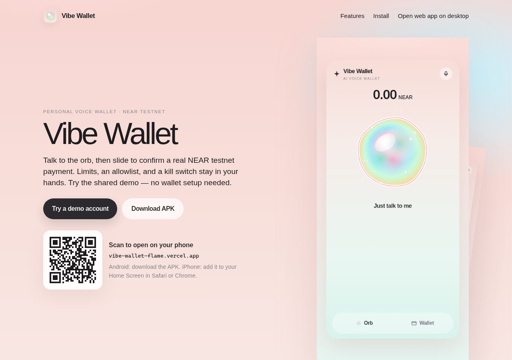
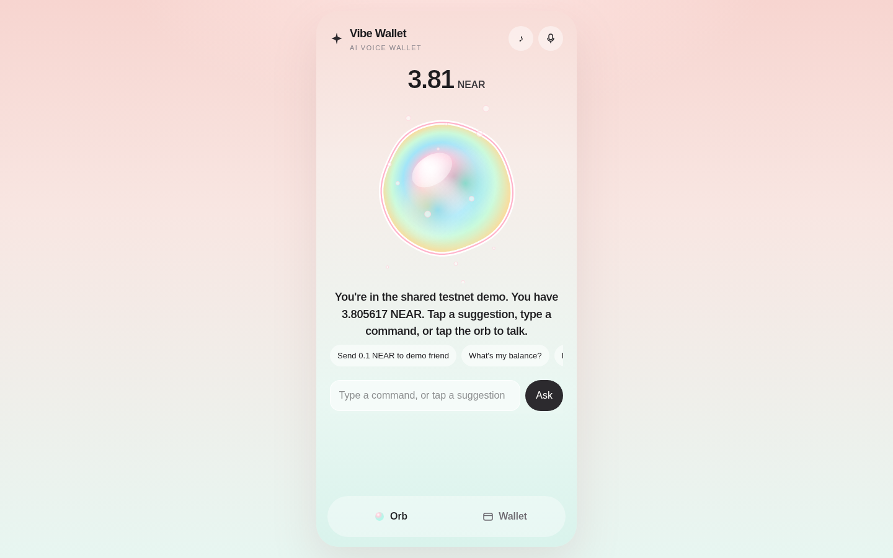
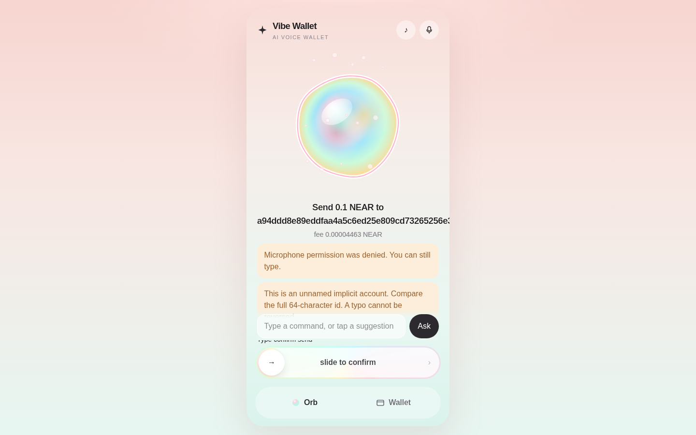
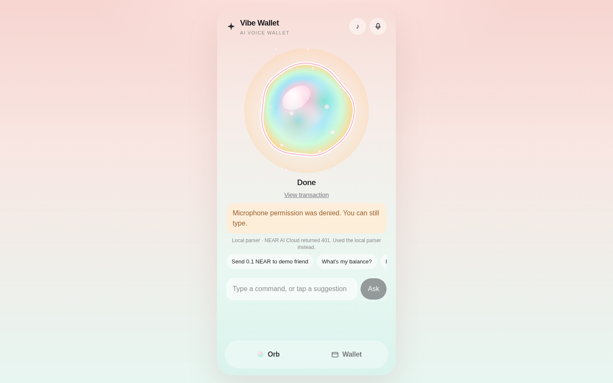
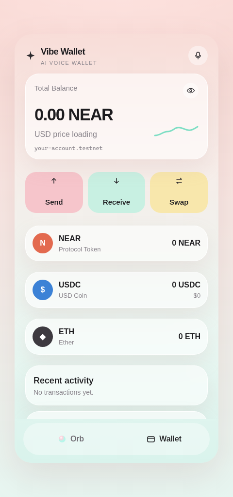
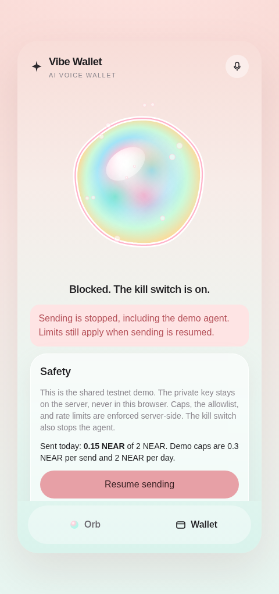
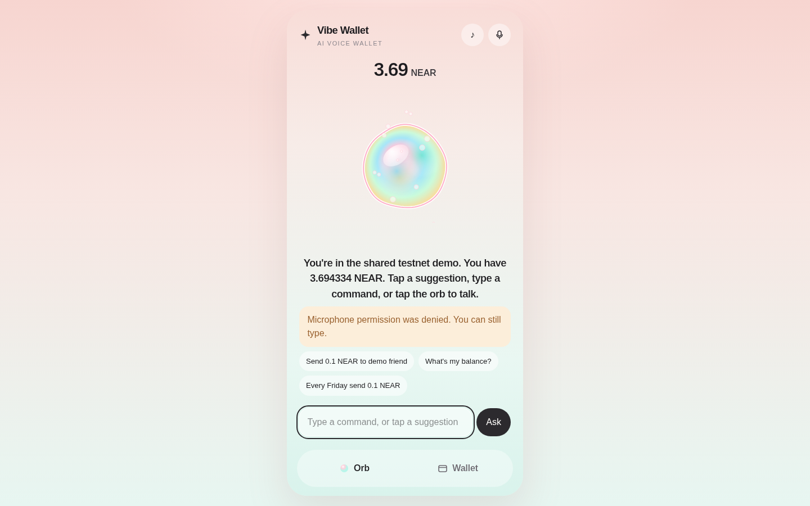
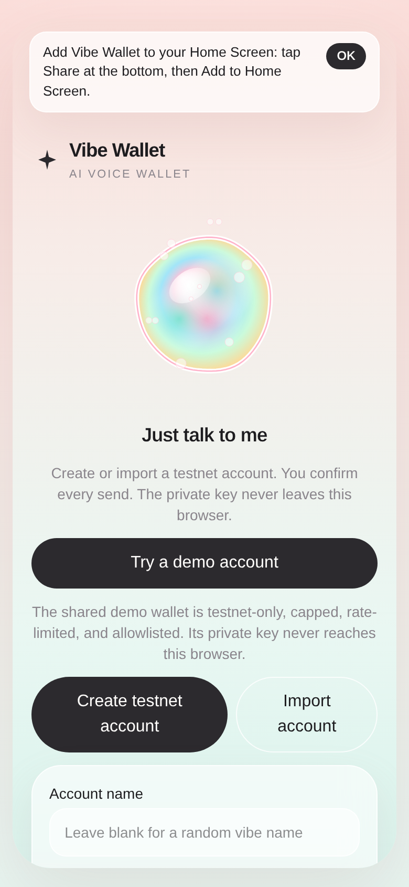
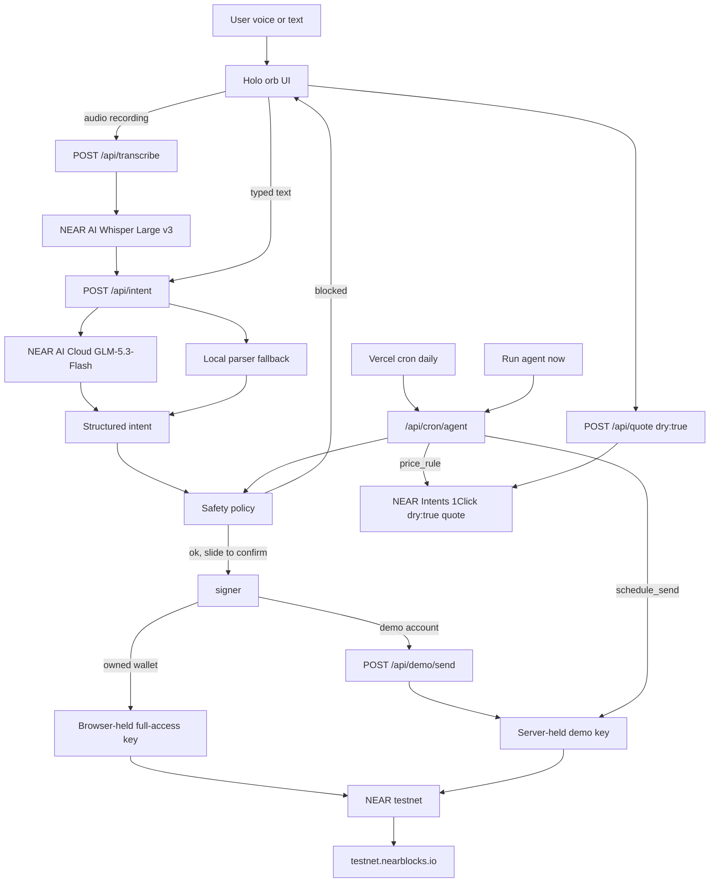

# Vibe Wallet

A personal NEAR testnet voice wallet you control by talking to a holographic orb. You say (or type) what you want, NEAR AI turns that into an intent, you slide to confirm, and a real testnet transfer is submitted. Spending limits, an allowlist, and a kill switch sit in front of every send. A server agent can run scheduled payments and price-trigger quotes.

This build is **NEAR testnet only**. Testnet NEAR has no monetary value. The app never sends or signs on mainnet.

- **Live app:** [https://vibe-wallet-flame.vercel.app](https://vibe-wallet-flame.vercel.app)
- **Android APK:** [https://vibe-wallet-flame.vercel.app/download/vibe-wallet.apk](https://vibe-wallet-flame.vercel.app/download/vibe-wallet.apk)
- **Demo video:** [`demo/vibe-wallet-demo.mp4`](demo/vibe-wallet-demo.mp4)

On a phone it opens as the app (PWA, or the signed Android wrapper). On a desktop it opens a landing page with a phone mockup, a scannable QR code, an APK download, and iPhone Safari + Chrome Home Screen steps. Add `/?app=1` to open the wallet on desktop.

Judges can click **Try a demo account** and use a shared, capped, rate-limited testnet wallet without creating an account. The demo private key stays on the server and is never sent to the browser.

## Features

- **Voice plus NEAR AI intents.** Tap the orb to record. Audio is transcribed with NEAR AI Cloud Whisper, then classified by NEAR AI (`z-ai/glm-5.3-flash`). You can also type or tap a suggestion. If the intent model is unavailable, a deterministic local parser is used and the UI says so.
- **Real testnet sends.** Confirmed transfers are real native `TRANSFER` actions on NEAR testnet, with a `https://testnet.nearblocks.io/txns/<hash>` link on success.
- **Agent rules.** Say `Send 0.15 NEAR to <account> every Friday` or `If NEAR drops below $Y, swap 0.1 NEAR to USDC`. A Vercel cron runs the agent daily (Hobby plan minimum), and judges can press **Run agent now**. Scheduled payments are real testnet transfers inside the same limits.
- **Guardrails and a kill switch.** Per-transaction and daily limits, an allowlist, and **Stop all sending**. The kill switch also stops the demo agent. Balance, history, and quotes still work.
- **Slide-to-confirm.** Payments and new rules require a slide (and the confirm phrase on the demo account). Nothing is signed until you confirm.
- **NEAR Intents, quote-only, labeled honestly.** Swap requests and price-trigger rules call the 1Click quote API with `dry: true`. Intents execution is mainnet-only, so this app never requests a deposit address and never signs a swap.

## Screenshots

| Desktop landing | In-app demo | Confirm a send |
| --- | --- | --- |
|  |  |  |

| Transaction done | Wallet | Safety |
| --- | --- | --- |
|  |  |  |

| Orb | Mobile |
| --- | --- |
|  |  |

## Architecture

## How NEAR products are used

- **NEAR testnet transfers.** Confirmed sends are real `TRANSFER` actions on testnet. Every success shows a testnet NearBlocks link.
- **Access keys.** For a personal wallet, a full-access key is encrypted in the browser and is the only key that can sign a native transfer. After unlock, the app adds a function-call key limited to `ft_balance_of` and `storage_balance_of` on `wrap.testnet`, with a 0.05 NEAR allowance. A function-call key cannot transfer NEAR. The demo account's full-access key never leaves the server.
- **NEAR AI Cloud.** `POST /api/transcribe` sends the recording to `openai/whisper-large-v3`. `POST /api/intent` calls `z-ai/glm-5.3-flash` when `NEAR_AI_API_KEY` is set. The key stays on the server. The model may only return a structured intent. If the key is missing or the intent call fails, a deterministic local parser is used and the UI says so.
- **NEAR Intents.** Swap requests and price-trigger rules call the 1Click quote API with `dry: true`. Quotes are labeled quote-only.

## Safety

- Kill switch: **Stop all sending**. It also stops the demo agent.
- Demo caps, enforced on the server: 0.3 NEAR per transaction, 2 NEAR per UTC day, allowlist-only, confirm phrase `confirm send`, extra confirm at or above 0.05 NEAR, rate limits of 8 sends/hour and 20/day per network.
- Personal wallet defaults (in the browser): 2 NEAR per transaction, 5 NEAR per day, extra confirm at or above 0.5 NEAR.
- When a command breaks a rule, the orb enters a **blocked** state, a red banner explains why, and the orb speaks the reason. Nothing is signed.

## How to run locally

Source lives in `app-v4/`.

1. `cd app-v4 && npm install`
2. `cp .env.example .env.local`
3. Optionally set `NEAR_AI_API_KEY`. Do not prefix it with `NEXT_PUBLIC_`.
4. For the demo account path, set `DEMO_NEAR_ACCOUNT_ID`, `DEMO_NEAR_PRIVATE_KEY`, `DEMO_RECIPIENT_ACCOUNT_ID`, and `AGENT_CRON_SECRET`. Store keys only in a local secrets directory, never in git.
5. `npm run dev` and open http://127.0.0.1:43123
6. `npm run test:logic` runs the parser, policy, and “API routes do not import the signer” checks.

`npm run build` then `npm start` serves the production build on the same port.

## Env vars

Names only. Never commit values.

| Name | Required | Purpose |
| --- | --- | --- |
| `NEAR_AI_API_KEY` | No | Server-only key for NEAR AI Cloud intents and Whisper transcription. Empty means the local intent parser, and typed commands still work. |
| `NEAR_AI_BASE_URL` | No | Defaults to `https://cloud-api.near.ai/v1`. |
| `NEAR_AI_MODEL` | No | Defaults to `z-ai/glm-5.3-flash`. |
| `NEAR_AI_STT_MODEL` | No | Defaults to `openai/whisper-large-v3`. |
| `DEMO_NEAR_ACCOUNT_ID` | For demo | Shared testnet demo account id. |
| `DEMO_NEAR_PRIVATE_KEY` | For demo | Server-only demo secret. Never `NEXT_PUBLIC_`. |
| `DEMO_NEAR_PUBLIC_KEY` | No | Expected public key for the demo signer. |
| `DEMO_RECIPIENT_ACCOUNT_ID` | For demo | Allowlisted testnet recipient used in examples. |
| `AGENT_CRON_SECRET` / `CRON_SECRET` | For cron | Authorizes `/api/cron/agent`. |
| `BLOB_READ_WRITE_TOKEN` | For agent state | Private Vercel Blob token used to persist demo agent state. |
| `NEXT_PUBLIC_NEAR_RPC_URL` | No | Defaults to `https://test.rpc.fastnear.com`. |
| `INTENTS_API_URL` | No | Defaults to `https://1click.chaindefuser.com/v0`. |

## Install

- **Desktop landing:** scan the QR, or open the site on a phone.
- **iPhone Safari:** Share → Add to Home Screen.
- **iPhone Chrome (iOS 16.4+):** Share icon in the address bar → Add to Home Screen.
- **Android:** install the signed APK from `/download/vibe-wallet.apk`, or use the PWA. You may need to allow installs from the browser. The APK wraps the live site and needs internet.

Do not use `https://vibe-wallet.vercel.app` — that is an unrelated third-party app. The live URL is `https://vibe-wallet-flame.vercel.app`.

## Tech stack

- Next.js 15 and React 19, deployed on Vercel
- Capacitor Android wrapper around the live site
- `near-api-js` against NEAR testnet (FastNEAR RPC)
- NEAR AI Cloud for intent classification and Whisper speech-to-text
- NEAR Intents 1Click API, quote-only (`dry: true`)
- Vercel Cron plus Vercel Blob for the demo agent

## What's real vs simulated

| Action | Real or simulated |
| --- | --- |
| Demo and personal native NEAR sends on testnet | Real testnet transactions, with a NearBlocks explorer link |
| Voice transcription | Real NEAR AI Cloud Whisper (`openai/whisper-large-v3`) |
| Intent classification | Real NEAR AI Cloud (`z-ai/glm-5.3-flash`) when the server key is set; otherwise a deterministic local parser, labeled in the UI |
| Scheduled agent payments | Real testnet transactions, inside the same limits |
| Swap / price-trigger | Real dry NEAR Intents quote only. No swap is executed |
| Mainnet | Never used |

## Sister project

Our team also built [TriagePay](https://github.com/KhomDev/TriagePay) at NEAR HACKATHON ([live demo](https://triagepay-demo.vercel.app)).

How the two differ:

- **Vibe Wallet is for people.** You talk to your NEAR wallet in plain words. NEAR AI turns what you say into a payment, a scheduled payment, a price rule or a swap quote, and you confirm with a slide.
- **TriagePay is for AI agents.** It's a policy wallet contract that lets an agent pay per API call over x402. Its limits, payee allowlist and owner review live on chain, so a prompt-injected agent's payment to an attacker is refused by the contract.

Both put guardrails between an AI and your money. In Vibe Wallet you approve each payment yourself, while in TriagePay the smart contract enforces the limits.
