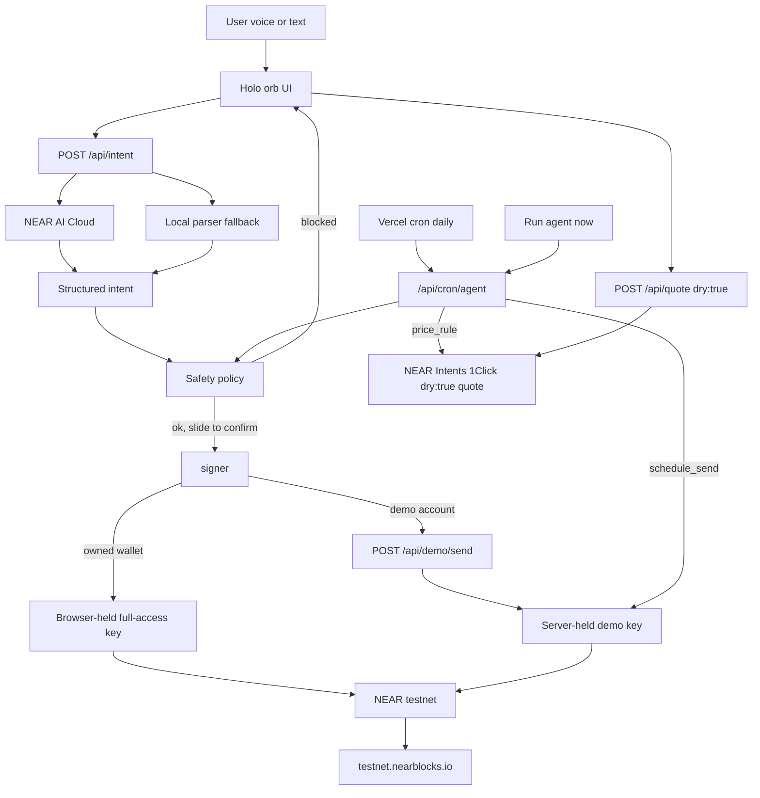

# Vibe Wallet

A personal NEAR testnet wallet you control by talking to a holographic orb. You say (or type) what you want, NEAR AI turns that into an intent, you slide to confirm, and a real testnet transfer is submitted. A kill switch, limits, and an allowlist sit in front of every send. A server agent can run scheduled payments and price-trigger quotes.

Live app: [https://vibe-wallet-flame.vercel.app](https://vibe-wallet-flame.vercel.app)

Android APK: [https://vibe-wallet-flame.vercel.app/download/vibe-wallet.apk](https://vibe-wallet-flame.vercel.app/download/vibe-wallet.apk)

Demo video: [`/workspace/vibe-wallet/demo/vibe-wallet-demo.mp4`](../demo/vibe-wallet-demo.mp4)

Other NEAR Hackathon entry by the same author: TBD (one person may enter at most two projects; this README will name the other entry before official submission).

The network in this build is **NEAR testnet only**. Testnet NEAR has no monetary value. This app never sends or signs on mainnet.

## What it is

Vibe Wallet is a personal voice wallet for one person. It is not a payments router, payroll tool, invoicing app, or merchant checkout. On a phone it opens as the app (PWA or the Android wrapper). On a desktop it opens a landing page with a QR code, an APK download, and iPhone Safari + Chrome Home Screen steps. Add `/?app=1` to open the wallet on desktop.

Judges can click **Try a demo account** and use a shared, capped, rate-limited testnet wallet without creating an account. The demo private key stays on the server and is never sent to the browser.

## Architecture

## How NEAR products are used

- **NEAR testnet transfers.** Confirmed sends are real `TRANSFER` actions on testnet. Every success shows a `https://testnet.nearblocks.io/txns/<hash>` link.
- **Access keys.** For a personal wallet, a full-access key is encrypted in the browser and is the only key that can sign a native transfer. After unlock, the app adds a function-call key limited to `ft_balance_of` and `storage_balance_of` on `wrap.testnet`, with a 0.05 NEAR allowance. A function-call key cannot transfer NEAR. The demo account's full-access key never leaves the server. API routes do not import `lib/near/signer.ts`.
- **NEAR AI Cloud.** `POST /api/intent` calls `https://cloud-api.near.ai/v1` with `z-ai/glm-5.3-flash` when `NEAR_AI_API_KEY` is set. The key stays on the server. The model may only return a structured intent. If the key is missing or the call fails, a deterministic local parser is used and the UI says so.
- **NEAR Intents.** Swap requests and price-trigger rules call the 1Click quote API with `dry: true`. Intents execution is mainnet-only, so this app never requests a deposit address and never signs a swap. Quotes are labeled quote-only.

## Safety

- Kill switch: **Stop all sending**. It also stops the demo agent. Balance, history, and quotes still work.
- Demo caps, enforced on the server: 0.3 NEAR per transaction, 2 NEAR per UTC day, allowlist-only, confirm phrase `confirm send`, extra confirm at or above 0.05 NEAR, rate limits of 8 sends/hour and 20/day per network.
- Personal wallet defaults (in the browser): 2 NEAR per transaction, 5 NEAR per day, extra confirm at or above 0.5 NEAR.
- When a command breaks a rule, the orb enters a **blocked** state, a red banner explains why, and the orb speaks the reason. Nothing is signed.
- Slide-to-confirm is required above the threshold (and for demo sends). The slider only appears when a payment or rule needs confirmation.

## Autonomous agent

From voice or text, you can add:

- `Send 0.15 NEAR to <account> every Friday` or `every day`
- `If NEAR drops below $Y, swap 0.1 NEAR to USDC`

A Vercel cron runs `/api/cron/agent` once per day (Hobby plan minimum). Judges can also press **Run agent now**. Scheduled payments are real testnet transfers inside the same limits. Price triggers fetch a live dry Intents quote and are clearly labeled quote-only. An activity log records what the agent did and why.

## How to run locally

1. `cd app-v4 && npm install`
2. `cp .env.example .env.local`
3. Optionally set `NEAR_AI_API_KEY`. Do not prefix it with `NEXT_PUBLIC_`.
4. For the demo account path, set `DEMO_NEAR_ACCOUNT_ID`, `DEMO_NEAR_PRIVATE_KEY`, `DEMO_RECIPIENT_ACCOUNT_ID`, and `AGENT_CRON_SECRET`. Store keys only in a local secrets directory, never in git.
5. `npm run dev` and open http://127.0.0.1:43123
6. `npm run test:logic` runs the parser, policy, and “API routes do not import the signer” checks.

`npm run build` then `npm start` serves the production build on the same port. Deploy with the Vercel CLI to the `vibe-wallet` project on Sina’s team only.

## Env vars

| Name | Required | Purpose |
| --- | --- | --- |
| `NEAR_AI_API_KEY` | No | Server-only key for NEAR AI Cloud. Empty means the local parser. |
| `DEMO_NEAR_ACCOUNT_ID` | For demo | Shared testnet demo account id. |
| `DEMO_NEAR_PRIVATE_KEY` | For demo | Server-only demo secret. Never `NEXT_PUBLIC_`. |
| `DEMO_NEAR_PUBLIC_KEY` | No | Expected public key for the demo signer. |
| `DEMO_RECIPIENT_ACCOUNT_ID` | For demo | Allowlisted testnet recipient used in examples. |
| `AGENT_CRON_SECRET` / `CRON_SECRET` | For cron | Authorizes `/api/cron/agent`. |
| `NEXT_PUBLIC_NEAR_RPC_URL` | No | Defaults to `https://rpc.testnet.near.org`. |
| `INTENTS_API_URL` | No | Defaults to `https://1click.chaindefuser.com/v0`. |

## Install

- **Desktop landing:** scan the QR, or open the site on a phone.
- **iPhone Safari:** Share → Add to Home Screen.
- **iPhone Chrome (iOS 16.4+):** Share icon in the address bar → Add to Home Screen.
- **Android:** install the signed APK from `/download/vibe-wallet.apk`, or use the PWA. You may need to allow installs from the browser.

Do not use `https://vibe-wallet.vercel.app` — that is an unrelated third-party app. The live URL is `https://vibe-wallet-flame.vercel.app`.
