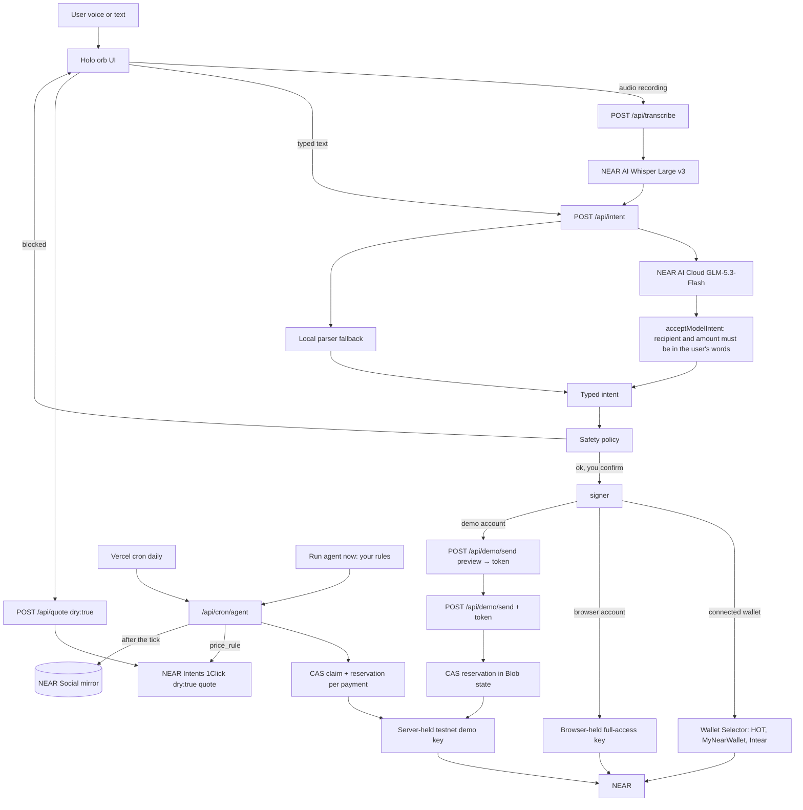

# Vibe Wallet architecture

Vibe Wallet is a Next.js 15 app deployed on Vercel. The Android APK is a Capacitor wrapper around the live site, so the same production build serves the web app, the PWA, and the APK.

## Request path

Every `/api` request passes `middleware.ts` first: a state-changing request from another site (`Sec-Fetch-Site`
or `Origin`) gets 403, a JSON route called without `application/json` gets 415, and every response is
`Cache-Control: private, no-store`. The cron route authenticates with `Authorization: Bearer <CRON_SECRET>`.

## Voice

Tap the orb to start recording. The client uses `getUserMedia` and `MediaRecorder` (`audio/webm;codecs=opus`, falling back to `audio/mp4` on iOS). Recording stops on a second tap, after about 1.4 seconds of silence, or after 8 seconds. The clip is posted to `/api/transcribe`, which calls NEAR AI Cloud `POST /v1/audio/transcriptions` with `openai/whisper-large-v3`. The transcript then follows the same intent path as typed text. Hands-free mode and voice confirm are described in [HANDS-FREE.md](HANDS-FREE.md).

The app does not depend on the browser's Web Speech API, which fails with a `network` error in Brave, Edge, the Android WebView, and some networks.

## Intents

`POST /api/intent` sends the utterance to `z-ai/glm-5.3-flash` with enough `max_tokens` for that reasoning model, and also reads `reasoning_content` if `content` is empty. If the key is missing, the per-client or per-instance rate limit is hit, or NEAR AI returns 401/402 or unusable JSON, a deterministic local parser answers and the UI labels the fallback. A message that looks like a private key or seed phrase is refused and never forwarded.

`acceptModelIntent` keeps a model intent only when the user's own words back it:

- the recipient of a send, schedule or allowlist addition is a whole account token in the message (not a substring of a longer id);
- the amount of a send, schedule or price rule is a number (or a simple number word) in the message;
- stop, resume, run_agent, quote and set_limit need a matching word;
- negated requests ("don't send …") and messages with invisible or combining characters fall back to the parser, which refuses them.

## Safety and signing

`assessSend` (`lib/policy.ts`) checks the kill switch, per-transaction and daily limits, the allowlist, account existence and the balance, and decides whether the confirm phrase is needed (recipient not allowlisted, amount at or above the extra-confirm threshold, implicit account, look-alike of a contact, most of the balance). It runs for the confirm card and again inside the signer.

- **Connected wallet:** `lib/near/wallet-connector.ts` sets up NEAR Wallet Selector 10.1.4 with HOT, MyNearWallet and Intear (loaded on demand, FastNEAR RPC). Sign-in passes no `contractId`, so no function-call key is requested; the app learns the account id only. `lib/near/wallet-send.ts` re-runs `assessSend` with live data and only then calls the wallet's `signAndSendTransaction`. The daily counter is reserved first, and a pending record is written before a browser wallet redirects away; on return, `takeWalletRedirect` reads `transactionHashes` or `errorCode` and the spend is kept or given back.
- **Browser account:** `lib/near/signer.ts` signs in the browser with the decrypted full-access key. It verifies the key is a full-access key for the account, runs `assessSend` with live data, holds a per-account lock (Web Locks across tabs), and broadcasts through `lib/near/broadcast.ts`, which computes the transaction hash before sending and looks it up if the send call fails. The daily counter is reserved right before broadcast and returned only if the send certainly did not happen.
- **Demo account:** `lib/server/transfer.ts` signs on the server, only on testnet (`NETWORK_ID` and the node's `chain_id`), one signature at a time per instance.
- API routes under `app/api` and `lib/server` never import the browser signer (a test checks this). Quotes are forced to `dry: true`.

## Executed NEAR Intents swaps (mainnet builds)

1. `POST /api/intents/quote` (mainnet only; refuses on a testnet build) asks 1Click for an executable quote (`dry: false`, `recipientType: DESTINATION_CHAIN`, recipient and refund = the user's account). It holds no key and signs nothing.
2. `verifyLiveQuote` (`lib/intents-swap-client.ts`) refuses a quote whose amount, origin or destination asset, recipient, refund account, deadline, deposit address or output does not match the request.
3. `readSwapChainState` reads, with view calls, the user's wNEAR balance and storage registration on `wrap.near` and on the destination token. `buildSwapTransactions` returns the exact transactions: an optional `storage_deposit` on the destination token, then one `wrap.near` transaction with an optional `storage_deposit` for the user, `near_deposit` for the shortfall only, `storage_deposit` for the deposit address, and `ft_transfer` of the quoted amount.
4. `assessSwap` (`lib/policy.ts`) applies the kill switch, per-send and daily limits, a balance check that includes storage deposits and fees, and a `SWAP_MAX_NEAR` ceiling. The phrase is always required.
5. The user's wallet (or the browser signer, restricted to `wrap.near` and the destination token) signs. `POST /api/intents/submit` reports the deposit transaction and `GET /api/intents/status` is polled until `SUCCESS`, `REFUNDED` or `FAILED`.

## Limits enforced on chain (TriagePay)

`lib/near/policy-wallet.ts` reads a [TriagePay](https://github.com/KhomDev/TriagePay) policy-wallet contract with `get_config`, `get_agent` and `get_review_policy` (view calls only). `components/OnChainLimitsCard.tsx` shows the result in the Wallet tab, and the `onchain_limits` intent ("show on-chain limits") opens it. Defaults: `tp-wallet.hlpok1lad.tg` / `tp-agent2.hlpok1lad.tg` on mainnet, `tpd-e947e7-wallet.testnet` / `tpd-e947e7-agent.testnet` on testnet. Vibe Wallet's own limits are app-enforced; TriagePay's are contract-enforced on every `pay`.

## Demo state and limits

`lib/server/state.ts` keeps one JSON document in private Vercel Blob: counters, per-visitor records (allowlist additions, stop switch), agent rules and logs, minted-id counts and used confirmation tokens. It is read with `useCache: false`, so content and ETag come from the same response. Every change goes through `transact`, which re-reads, applies a pure function, and writes with `ifMatch` on that snapshot's ETag, retrying on conflict. Writes that change nothing are skipped. Stored rules, logs and links are schema-validated on every read. Locally, without a Blob token, a JSON file with a revision number plays the same role.

A demo send is two requests:

1. `preview: true` runs the policy and the server-side gate and returns an HMAC confirmation token bound to visitor, recipient and amount (`lib/server/confirm-token.ts`, valid 5 minutes).
2. The send verifies the token, then in one `transact` re-checks the kill switches, the allowlist and every limit, reserves the spend and records the token as used. Only then is the transfer signed. A send that certainly did not happen gives the reservation back; an unknown outcome keeps it counted.

Visitors are identified by an HMAC-signed httpOnly cookie minted only by `POST /api/demo/session`, at most 20 per network per UTC day (`lib/server/visitor.ts`). The network key is a salted hash of the client IP (`x-real-ip` on Vercel, IPv6 /64). Limits are in `lib/server/demo-limits.ts` and in the README.

## Agent

Rules belong to the visitor who created them (`owner`, plus `ownerNet`). A scheduled payment must go to that visitor's allowlist and is capped per send. `POST /api/agent/run` runs only the caller's due rules (6 runs per hour per visitor); the daily Vercel Cron runs everyone's. Each payment is claimed in one `transact`: mark the rule as run today, lease it, re-check the stop switches and allowlist, and reserve the spend against the owner's visitor, network and global limits. A concurrent tick sees the claim and skips the rule. Price triggers only fetch a dry Intents quote.

After the cron tick, `mirrorToSocial` writes a public projection (rules, payment hashes, global kill switch, global spend; no visitor keys or allowlists) to NEAR Social testnet, only when it changed and with no deposit. It is never read back.

## Networks

Testnet is the default. `NEXT_PUBLIC_NEAR_NETWORK=mainnet` switches RPC, explorer, indexer, the scoped-key contract and bare-name resolution (`bob` → `bob.near`) for the personal wallet. The shared demo signer refuses to sign on anything but testnet. Executed Intents swaps run only on mainnet; see [MAINNET.md](MAINNET.md).

## Android wrapper

`capacitor.config.ts` loads `https://vibe-wallet-flame.vercel.app` and allows navigation only to that host. From APK 1.2: `allowBackup="false"` and data-extraction rules that exclude everything, a network security config (HTTPS only, system CAs only), a WebView permission handler that grants only microphone capture and only to the app's origin, and `FLAG_SECURE`.

## Source layout

| Path | What it is |
| --- | --- |
| `app-v4/` | Next.js app, API routes, middleware, Android project |
| `app-v4/app/api/` | Intent, transcribe, quote, demo, agent, and cron routes |
| `app-v4/middleware.ts`, `lib/request-guard.ts` | Cross-site and content-type guard for `/api` |
| `app-v4/lib/` | Parser, policy, vault, NEAR helpers, voice recorder |
| `app-v4/lib/server/` | Demo state (CAS), limits and reservations, visitor ids, confirmation tokens, rate limits, demo signer, agent |
| `app-v4/lib/near/wallet-connector.ts`, `wallet-send.ts` | NEAR Wallet Selector setup and connected-wallet sends |
| `app-v4/lib/intents-swap-client.ts`, `app/api/intents/` | Confirm-card Intents swap: quote verification, exact transactions, status |
| `app-v4/lib/near/policy-wallet.ts`, `components/OnChainLimitsCard.tsx` | Live read of a TriagePay policy wallet |
| `app-v4/lib/server/intents-swap.ts` | Executed NEAR Intents swap with a server-held key, used by the mainnet proof script |
| `app-v4/scripts/mainnet-check.ts` | Key-free mainnet check of the current logic |
| `app-v4/scripts/mainnet-proof.ts` | Mainnet proof: signer transfer plus executed Intents swap (`--broadcast`) |
| `app-v4/scripts/e2e-http.mjs` | HTTP end-to-end check of a running build against testnet |
| `docs/` | Architecture, security review, testing notes, evidence, screenshots |
| `demo/` | Narrated demo video |
