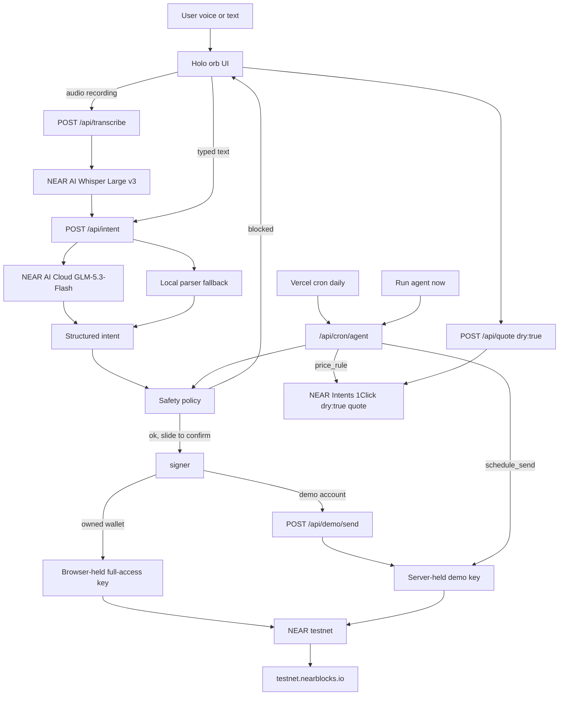

# Vibe Wallet architecture

Vibe Wallet is a Next.js 15 app deployed on Vercel. The Android APK is a Capacitor wrapper around the live site, so the same production build serves the web app, the PWA, and the APK.

## Request path

## Voice

Tap the orb to start recording. The client uses `getUserMedia` and `MediaRecorder` (`audio/webm;codecs=opus`, falling back to `audio/mp4` on iOS). Recording stops on a second tap, after about 1.4 seconds of silence, or after 8 seconds. The clip is posted to `/api/transcribe`, which calls NEAR AI Cloud `POST /v1/audio/transcriptions` with `openai/whisper-large-v3`. The transcript then follows the same intent path as typed text.

This path is used everywhere. The app does not depend on the browser's Web Speech API, which fails with a `network` error in Brave, Edge, the Android WebView, and some networks.

The Android wrapper declares `RECORD_AUDIO` and `MODIFY_AUDIO_SETTINGS`, requests them at launch, and grants WebView `onPermissionRequest` for microphone capture.

## Intents

`POST /api/intent` sends the utterance to `z-ai/glm-5.3-flash` with enough `max_tokens` for that reasoning model, and also reads `reasoning_content` if `content` is empty. If the key is missing, or NEAR AI returns 401/402 or unusable JSON, a deterministic local parser answers and the UI labels the fallback.

`acceptModelIntent` rejects a model-invented recipient that does not appear in the user's words, and falls back to the local parser.

## Safety and signing

Every send is checked against the kill switch, per-transaction and daily limits, allowlist, and account-existence rules. Demo sends are signed only on the server. Personal-wallet sends are signed only in the browser. API routes under `app/api` and `lib/server` do not import the signer. Quotes are forced to `dry: true`.

## Networks

Testnet is the default. `NEXT_PUBLIC_NEAR_NETWORK=mainnet` switches RPC, explorer, indexer, and the scoped-key contract. Executed Intents swaps run only on mainnet; see [MAINNET.md](MAINNET.md).

## Agent

Rules live with demo agent state in private Vercel Blob (and are also reflected on NEAR Social testnet in this build). Vercel Cron hits `/api/cron/agent` once a day. Judges can press **Run agent now**. Scheduled payments are real testnet transfers inside the same limits. Price triggers only fetch a dry Intents quote.

## Source layout

| Path | What it is |
| --- | --- |
| `app-v4/` | Next.js app, API routes, Android project |
| `app-v4/app/api/` | Intent, transcribe, quote, demo, agent, and cron routes |
| `app-v4/lib/` | Parser, policy, NEAR helpers, voice recorder |
| `app-v4/lib/server/intents-swap.ts` | Executed NEAR Intents swap via 1Click (mainnet only) |
| `app-v4/scripts/mainnet-proof.ts` | Mainnet proof: signer transfer plus executed Intents swap |
| `docs/` | Architecture, testing notes, and screenshots |
| `demo/` | Narrated demo video |
